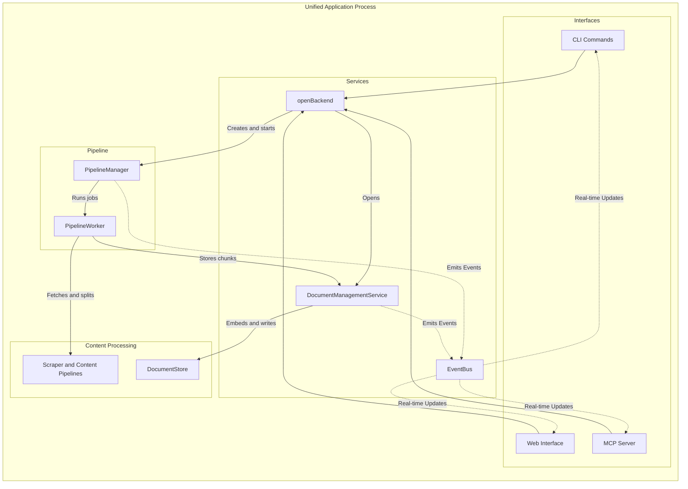
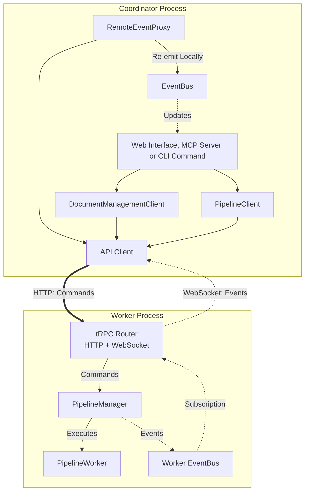
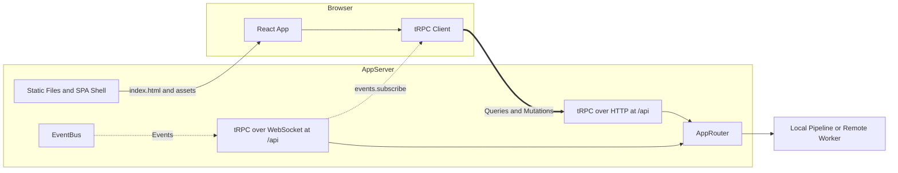

# Documentation MCP Server Architecture

## System Overview

The Documentation MCP Server indexes documentation and makes it searchable for AI coding assistants. It fetches content from websites, GitHub repositories, npm and PyPI packages, and local files and archives. It splits the content into chunks and stores them in SQLite with a full-text index and, when an embedding model is configured, vector embeddings. Search, library management and job control are available over the Model Context Protocol (MCP), the CLI and a web interface.

Each library version is indexed and searched on its own. Indexing runs as asynchronous jobs whose state is stored with the version, so a worker that restarts can pick up the jobs an earlier run left unfinished.

This document is the overview. The documents under [References](#references) cover each area in depth. [AGENTS.md](AGENTS.md) holds the development workflow, code style, logging and testing conventions.

### Technology Stack

- Node.js 22 and TypeScript. Vite builds the server and the web interface, and Vitest runs the tests.
- SQLite through better-sqlite3, with FTS5 for full-text search and sqlite-vec for vectors. SQL migrations live in `db/migrations/`.
- LangChain.js for the embedding clients (OpenAI and OpenAI-compatible APIs, Google Gemini and Vertex AI, AWS Bedrock, Azure OpenAI) and for recursive text splitting. tree-sitter parses source code.
- Playwright with Chromium renders JavaScript pages and fetches pages behind anti-bot challenges. Xberg extracts text from PDF, Office and other binary documents.
- Fastify serves HTTP. tRPC carries the application API and its WebSocket event stream. The MCP TypeScript SDK implements the MCP server.
- The web interface uses React, React Router, tRPC and TanStack Query, styled with plain CSS.

### Source Layout

| Path | Contents |
|---|---|
| `src/index.ts`, `src/cli/` | Entry point and the CLI commands; every server mode starts here |
| `src/app/` | `AppServer` (Fastify), public URL and base-path handling, host and origin policy |
| `src/services/` | `openBackend`, the API client, the merged tRPC router, the MCP HTTP service |
| `src/mcp/` | MCP server, tool registration, stdio transport, built-in instructions |
| `src/tools/` | Business logic shared by the CLI and MCP |
| `src/pipeline/` | Job queue, job execution and the client for a remote worker |
| `src/events/` | `EventBus` and the relay for a remote worker's events |
| `src/scraper/` | Source strategies, fetchers, middleware and content pipelines |
| `src/splitter/` | Chunking: semantic, greedy, JSON, text and source-code splitters |
| `src/store/` | SQLite store, document management, search, result assembly, embeddings |
| `src/auth/` | Access-token verification and protected resource metadata for the MCP endpoint |
| `src/telemetry/` | Usage telemetry (PostHog) |
| `src/utils/` | Configuration, logging, paths, URL and MIME helpers, archive readers |
| `src/types/` | Shared type declarations |
| `src/web/client/` | React web interface; see its [conventions](src/web/client/CONVENTIONS.md) |
| `db/migrations/` | SQL schema migrations |

## Configuration

Configuration comes from four layers, each overriding the one before: built-in defaults, the config file (`config.yaml`), environment variables, and CLI arguments. `loadConfig` in `src/utils/config.ts` merges them and validates the result against one Zod schema, so the rest of the code receives a fully typed `AppConfig`.

A config file named with `--config` or `DOCS_MCP_CONFIG` is read-only to the server. Without one, the server uses the file in the system configuration directory and writes new default values back to it at startup. See [Configuration](docs/setup/configuration.md) for the options and their environment variables.

## System Architecture

Interfaces delegate to shared tools and services, which run jobs through the pipeline and read and write the store. The same components run in one process, or split between coordinators and a shared worker.

### Unified Mode (Local In-Process)

In unified mode, all components run in one process. The default command serves the MCP endpoint, the web interface and the API together. `web`, `mcp`, `scrape` and `refresh` start their own pipeline when they have no `--server-url`. `PipelineManager` runs jobs in the process and emits events to the local `EventBus`, which every interface reads.



### Distributed Mode (Hub & Spoke)

In distributed mode, the worker runs as a separate process. Coordinators (the web server, the MCP server over HTTP or stdio, and CLI commands given `--server-url`) reach the shared worker through the same application API the web UI uses. Each opens a remote backend: one typed API client for the worker URL, with `DocumentManagementClient` and `PipelineClient` calling its procedures over HTTP, and a `RemoteEventProxy` that subscribes to the worker's events over one WebSocket and re-emits them on the local `EventBus`. Consumers use the same interfaces and the same bus as in unified mode.



One worker runs every job, and any number of coordinators share it. Commands travel over HTTP and events over one WebSocket; both links come from `src/services/apiClient.ts`, which the web UI uses too.

Every remote backend that has a pipeline relays the worker's events. A command waits briefly for the event stream before its first job. When the stream returns after a drop, the relay emits `JOB_LIST_CHANGE` and `LIBRARY_CHANGE` so views refetch what they missed.

### Backend Selection

Every entry point opens its services with `openBackend()` (`src/services/backend.ts`), which decides local or remote from the worker URL and owns starting and stopping what it creates. Naming clarifies the mode: PipelineManager runs an in-process worker; PipelineClient uses an out-of-process worker.

- `serverUrl` specified: a remote backend. Its API client's HTTP calls and its event WebSocket use the same worker URL, path included, so a worker behind a path-prefixed reverse proxy works.
- `jobs: false`: documents only, for read-only commands and the CLI `remove`; no pipeline, and no WebSocket to a worker. A remote store removes a version through the worker's `removeDocs`, which cancels the worker's job for it first.
- `jobs: { interruptedJobs }`: a started PipelineManager locally, with a policy for the jobs an earlier run left unfinished; the worker's pipeline remotely. Server commands host the store and recover or fail those jobs, but only the ones no live process marks alive; `scrape`, `refresh` and read-only servers run only their own job, or none, and leave the rest to the server. See [Interrupted Jobs](docs/concepts/pipeline-architecture.md#interrupted-jobs).

### Servers and Protocols

`AppServer` composes the HTTP surface for each server command. The default command serves the MCP endpoint, the web interface and the API. `web` serves the web interface and the API, `mcp` over HTTP serves only the MCP endpoint, and `worker` serves only the API.

Outside Docker, the default command and `mcp` choose their MCP transport from the terminal. When neither stdin nor stdout is a TTY, as when an AI tool launches the server, they serve MCP over stdio. Otherwise they start the HTTP server, with MCP over Streamable HTTP at `/mcp`. `--protocol stdio|http` overrides the detection.

The Docker image sets `DOCS_MCP_PROTOCOL=http` and `HOST=0.0.0.0`, so a container started without arguments serves HTTP on all interfaces even without a TTY. These are ordinary environment defaults: a variable passed to `docker run` or a CLI flag overrides them. Docker stdio clients pass `--protocol stdio` and keep stdin open with `docker run -i`.

CI builds and runs the production Docker image's E2E suite on native x86-64 and ARM64 Linux runners. Each architecture uses its own build cache. Release builds publish both architectures under the same image tag.

## Core Components

### Tools Layer

Business logic lives in `src/tools/`, one class per operation: scraping and refreshing, search, listing libraries and pages, finding a version, reading a page, removing documents, job control, and fetching a single URL as Markdown. The CLI commands and the MCP tools call these classes, so both interfaces behave the same. The web interface calls the application API, which exposes the same pipeline and document services.

### Pipeline Management

The pipeline runs jobs asynchronously, persists their state, and reports their progress as events. See [Pipeline Architecture](docs/concepts/pipeline-architecture.md) and [Event Bus Architecture](docs/concepts/eventbus-architecture.md).

`PipelineManager` owns the job queue and the concurrency limit. It writes every job state change to the database as it happens (write-through), so the job record in the store is always current and a restarted process can find unfinished jobs. It emits each change on the `EventBus`.

`PipelineWorker` executes one job: it runs the scrape and stores each page's chunks through `DocumentManagementService`. It reports progress to the manager, which turns it into events.

`PipelineClient` provides the same pipeline interface for a remote worker by calling the worker's API, and keeps no job state of its own. Before its first job it waits briefly for the event stream, so a job that starts at once does not lose its first events. See [Remote Pipeline](docs/concepts/pipeline-architecture.md#remote-pipeline).

`RemoteEventProxy` bridges events from a remote worker to the local `EventBus` through one subscription on the backend's API client. The WebSocket client reconnects dropped connections; the proxy subscribes again when the subscription itself ends. Its live state backs the web server's `worker.connected` health field.

`EventBus` is the in-process publish and subscribe service between producers (`PipelineManager`, `DocumentManagementService`) and consumers (CLI, web interface, MCP), so the components do not depend on each other directly.

Job states progress through QUEUED, RUNNING, and then COMPLETED, FAILED or CANCELLED, with a running job passing through CANCELLING until it stops writing. See [Job Lifecycle](docs/concepts/pipeline-architecture.md#job-lifecycle).

### Content Processing

A scrape runs through three layers. A scraper strategy (`src/scraper/strategies/`) handles one kind of source: websites, GitHub repositories, npm and PyPI packages, or local files and archives. It discovers pages and fetches each one through a fetcher, which reads over HTTP, through a headless browser, or from the file system. A content pipeline, chosen by MIME type, turns the raw content into chunks. HTML and Markdown pass through a middleware chain that extracts the content, metadata and links. PDF, Office and other binary documents go through Xberg. JSON and source code have their own pipelines, and a text pipeline takes everything else. The store then embeds the chunks and writes them. See [Content Processing](docs/concepts/content-processing.md) and [Supported Formats](docs/concepts/supported-formats.md).

Most pipelines split in two phases: a structure-aware splitter cuts along the document's headings, code blocks, tables and lists, and `GreedySplitter` then merges small chunks up to the configured size. The JSON and source-code pipelines use their own splitters. See [Splitter Hierarchy](docs/concepts/splitter-hierarchy.md) and [Source Code Splitter](docs/concepts/source-code-splitter.md).

`TextContentSplitter`, which the Markdown, text and source-code splitters use for plain text, enforces a fence-balance invariant: no chunk boundary may fall inside an open ` ``` ` or `~~~` fenced code block, even when the block is embedded in a list item, blockquote, or arbitrary wrapper. When honoring this invariant would force a chunk past `maxChunkSize`, the splitter accepts the oversize chunk (logging a warning) rather than break the fence. Downstream renderers and LLM consumers always get balanced fences.

Web fetches ask for Markdown first in their `Accept` header. A Markdown response goes to `MarkdownPipeline`, and HTML goes to `HtmlPipeline`. During scrapes and refreshes, `WebScraperStrategy` also looks for an `llms.txt` file near the start URL and at the site root. It queues the Markdown links the file lists once the start page has fixed the crawl's scope, and fetches the `.md` variant of each listed page first. A page fetched as its Markdown variant is stored under its canonical URL, so both forms of a page are one page.

#### Browser lifecycle

A web scrape runs one headless Chromium. `WebScraperStrategy` creates a `ManagedBrowser` ([src/scraper/fetcher/ManagedBrowser.ts](src/scraper/fetcher/ManagedBrowser.ts)) and hands it to both users of a browser: `BrowserFetcher`, which `AutoDetectFetcher` falls back to when a plain HTTP request meets a challenge or an anti-bot block, and `HtmlPlaywrightMiddleware`, which renders HTML in `playwright` and `auto` scrape modes. Each page gets its own browser context, so pages share the process but not cookies or storage.

`ManagedBrowser` launches Chromium on first use and launches a new one after the old one exits, for example when the operating system kills it under memory pressure. Callers that need a browser at the same time share one launch. `BrowserFetcher` retries a page once on the new browser when Chromium dies while loading it, unless the fetch was aborted. `HtmlPlaywrightMiddleware` replaces the browser only when a page or context fails to close in time, since a stuck cleanup can leave Chromium unresponsive; a failed render alone keeps the browser, which other pages may be using. Closing the browser is bounded by `scraper.pageTimeoutMs` (navigation itself by `scraper.browserTimeoutMs`) and falls back to killing the process, by the process ID Chromium reports over CDP at launch.

Each page's routes check the requests it makes against the access policy, but Playwright routes only the first request of a redirect chain: Chromium follows redirects itself. So at launch, `ManagedBrowser` opens a CDP Fetch session on the browser target, which pauses every request in every context, including those of cross-site iframes that run in processes of their own. The session fails each redirect hop the policy denies, and a browser whose session cannot be set up is closed instead of handed out. `BrowserFetcher` reports a navigation stopped this way as an `AccessPolicyError`.

A crawl that ends early, because an item failed or the job was cancelled, aborts the items still running and waits for them before it returns. `ScraperService` cleans up the strategy, and with it the browser, only after that, so no item is left using a closed browser or launching a new one that nobody closes. An aborted browser fetch closes its context, which ends a navigation in progress.

Playwright's headless shell is the default binary. Installs made with `playwright install --no-shell` have only the full Chromium build, and the launch falls back to it. `PLAYWRIGHT_CHROMIUM_EXECUTABLE_PATH` overrides both. When neither of Playwright's builds is installed, a system Chromium (`/usr/lib/chromium/chromium`, `/usr/bin/chromium` or `/usr/bin/chromium-browser`) is used if one exists.

Commands that can launch a browser in their own process (the default server, `mcp`, `worker`, `fetch-url`, and `scrape`, `refresh` and `web` without `--server-url`) make sure one is installed before they start. Either of Playwright's builds counts. When both are missing, the command installs the headless shell with the CLI of the bundled Playwright, so the revision matches what the launch looks for. The install runs with `--no-remove`, because another process may be running browsers that Playwright would otherwise delete as unused.

#### Sub-resource blocklist

During Playwright-driven page rendering, `HtmlPlaywrightMiddleware` aborts requests to a small, hand-curated list of third-party hosts that pages commonly load but that never carry documentation content: analytics SDKs, session-replay agents, chat widgets, captcha runtimes, and social-embed runtime JS. The list lives in [src/scraper/middleware/subresourceBlocklist.ts](src/scraper/middleware/subresourceBlocklist.ts) and matches on hostname suffix (with a label boundary) plus an optional path prefix. Two categories are deliberately excluded: advertising networks, to avoid triggering anti-adblock detection on monetized sites, and generic CDNs (unpkg, jsDelivr, cdnjs), because pages legitimately fetch content-bearing libraries from them. The top-level navigation and any iframe document navigations are always exempt — the check short-circuits on Playwright's `resourceType === "document"`. The feature is governed by a single config flag, `scraper.skipKnownTrackers`, which defaults to `true`.

#### Unprocessable-content filtering

The crawler declines to download resources no content pipeline can read. What "can read" means is derived from the pipelines themselves — [src/scraper/pipelines/capability.ts](src/scraper/pipelines/capability.ts) builds a predicate by asking each pipeline's own `canProcess()` — so support for a format is declared in exactly one place. Adding a pipeline widens the crawler automatically; no second list needs updating.

Two gates consult that predicate:

- **Queue-time**, in `WebScraperStrategy`'s discovered-link filter. A MIME type is detected from the link's *pathname* (not its href, so a host like `example.zip` cannot resolve an archive type off its TLD) and the link is dropped before any request when the type names binary media — `image/*`, `video/*`, `audio/*`, `font/*` — that no pipeline claims. The binary-media condition is what makes an extension trustworthy enough to act on without asking the server: `application/*` is deliberately excluded, because the `mime` package files plain-text scripts there (`.csh`, `.tcl`, `.bat`, `.scm`, `.ps` all resolve to `application/*` types that pipelines read fine).
- **Fetch-time**, in `HttpFetcher`. Responses are streamed, so the `Content-Type` is checked after redirect resolution and the access-policy check but before the body is read. A rejected response has its stream destroyed and is reported as `FetchStatus.SKIPPED`. This is the authoritative gate — it catches extensionless URLs and extensions that disagree with what the server actually serves.

A skipped resource is neither content nor a failure: it stores no page and is excluded from the child-page failure rate, so an asset-heavy site cannot trip `scraper.abortOnFailureRate`. Skips are logged at `debug` only.

There is no configuration flag. The fetch-time gate applies the same predicate the pipeline-selection loop already applies, just earlier, so disabling it would produce a byte-identical index more slowly. On the reference crawl used for issue #490 the two gates cut HTTP requests from 2158 to 1013 and removed roughly 265 MB of discarded image downloads, while indexing exactly the same 806 documents.

#### Scrape progress counters

A scrape reports four counters. `totalDiscovered` counts URLs admitted to the queue; `totalPages` is how many items the job expects to process; `pagesScraped` counts items dequeued and given an outcome; `pagesIndexed` counts those that produced stored content. The first two move at enqueue, the last two at outcome.

`pagesScraped` converges on `totalPages` because every queued item reaches exactly one outcome — depth, scope, patterns and content type are all filtered before admission, so nothing is queued and then silently discarded. `maxPages` bounds `pagesIndexed` rather than attempts, so asking for 100 pages yields 100 pages; the denominator stretches by the number of items that produced nothing, which keeps the fraction able to complete.

Every event names its outcome — stored, unchanged, absent, empty, skipped or failed. This matters most for the two that both arrive without content: a `304` is unchanged and the stored page is kept, while an empty `200` means the page exists and holds nothing, and its stored content is replaced. When a pipeline errors while producing nothing, nothing has been learned about the page, so the previous content is left alone and the response validator withheld, which keeps the next refresh unconditional instead of caching a failure forever. See [Refresh Architecture](docs/concepts/refresh-architecture.md).

### Storage and Search

The store is one SQLite database. The `libraries`, `versions`, `pages` and `documents` tables form a normalized hierarchy, where `documents` holds the chunks. `documents_fts` (FTS5) and `documents_vec` (sqlite-vec) index the chunks, and triggers keep them in step. The `metadata` table records the active embedding model, so a changed model is detected at startup. A version row is also the job record: it holds the job's status, progress and error, and the scraper options, so a refresh repeats the original scrape. See [Data Storage](docs/concepts/data-storage.md).

`DocumentManagementService` manages libraries and versions and resolves version labels. `DocumentStore` runs hybrid search: it fuses full-text and vector results with Reciprocal Rank Fusion, using configurable weights and an overfetch factor, and its full-text query matches the whole phrase as well as the single terms. Without an embedding model, search uses the full-text index alone. `DocumentRetrieverService` expands each hit with the surrounding chunks, using an assembly strategy chosen by content type. See [Search Result Reassembly](docs/concepts/search-result-reassembly.md).

## Interface Implementations

### Web Interface

The web interface is a React single-page application in `src/web/client/`. React Router handles client-side routes, and a typed tRPC client with TanStack Query (React Query) fetches and caches data. Styling is plain CSS: design tokens and themes in `styles/theme.css`, component classes in `styles/components.css`. `vite.config.web.ts` builds the app into `public/` (`npm run build:web`) with relative asset URLs, so one build works at the server root and under any public URL path.



`AppServer` serves the app when the web interface is enabled (the default command and `web`):

- Static files: `@fastify/static` serves `public/`, which holds the hashed build assets and the favicons.
- SPA shell: `/`, `/index.html` and every other unmatched `GET` or `HEAD` request get `index.html` with a `<base href>` for the public URL's path, so deep links and page reloads open the app. Unmatched paths under `/api`, `/mcp`, `/assets`, `/.well-known`, `/sse` and `/messages` get a JSON `404`.
- API: the merged tRPC router (`AppRouter` in `src/services/appRouter.ts`) at `/api`. Queries and mutations use HTTP; the `events.subscribe` subscription uses a WebSocket on the same path. The `worker` command serves the API without the web interface.

The browser builds its links with `createApiLinks()` from `src/services/apiClient.ts`, the same function coordinators use to reach a remote worker, and imports `AppRouter` as a type only, so no server code enters the browser bundle. The app shell holds one event subscription for job and library events and invalidates the affected queries, so every view refetches as jobs run and the corpus changes.

With `--server-url`, the web server's `/api` answers through its remote backend: `DocumentManagementClient` and `PipelineClient` forward calls to the worker, and `RemoteEventProxy` relays the worker's events onto the local `EventBus` that the subscription reads. The browser talks only to the web server.

Every request and WebSocket upgrade passes the host check (see [MCP Protocol Integration](#mcp-protocol-integration)). On a loopback bind, the API and its WebSocket also refuse foreign browser origins. Upgrades are accepted only at `/api`, and at the root for coordinators of earlier releases. Authentication covers the MCP endpoint only, never the web interface or the API.

See [Web Client Conventions](src/web/client/CONVENTIONS.md) for the client's directory layout, adding pages and routes, data hooks, and the shared component library.

### MCP Protocol Integration

The MCP server publishes the tools layer as MCP tools. It is built on the MCP TypeScript SDK v2 and has these transports and checks:

- stdio transport: for AI tools that launch the server as a child process. It serves clients on protocol revision 2026-07-28 and on earlier, handshake-based revisions.
- HTTP transport: Streamable HTTP at `/mcp`, for protocol revision 2026-07-28 and, statelessly, for clients on earlier handshake-based revisions. The SDK's per-request handler is mounted on the application's Fastify route. Before it, the route checks the browser `Origin`, answers CORS preflights and non-POST methods, and verifies bearer tokens when authentication is enabled.
- Host check: a global hook refuses (`403`) every request and WebSocket upgrade whose `Host` names an unknown host, which stops DNS rebinding. Accepted are IP literals, `localhost`, single-label names, the public URL's host and the hosts of `server.allowedOrigins` (`createHostPolicy` in `src/app/originPolicy.ts`).
- Deprecated HTTP+SSE transport: `GET /sse` and `POST /messages`, registered only while authentication is off, for handshake-era clients. It uses the SDK's frozen `SSEServerTransport` from `@modelcontextprotocol/server-legacy`, with one MCP server instance per stream, and goes away in a future major release.

When authentication is enabled, the HTTP transport acts as an OAuth 2.0 resource server. It publishes protected resource metadata and accepts only JWTs the configured identity provider issued for its public URL; see [Authentication](docs/infrastructure/authentication.md).

All advertised URLs derive from one resolved public location (`server.publicUrl`). The server answers every route with or without that URL's path prefix, so it runs behind reverse proxies that strip the prefix or forward it; see [Reverse Proxy Deployment](docs/infrastructure/reverse-proxy.md).

The MCP tools cover search, scraping and refreshing, library and version lookup, page browsing, job control, removal, and URL fetching. They call the same tool classes as the CLI. Read-only mode leaves out the scraping, job and removal tools.

During initialization the server sends instructions that clients add to the model's context. Tool descriptions explain one tool each; the instructions explain how the tools work together. Configured instructions (`server.instructions` or `server.instructionsFile`) replace the built-in text entirely. The built-in text depends on read-only mode and names only the tools registered in that mode.

## Benchmarking

A search-quality benchmark measures the retrieval quality of `SearchTool`. It computes deterministic IR metrics (MRR, Recall@k, nDCG@k, Hit@k) against a labelled dataset, plus LLM-judged scores for chunk coherence, faithfulness and answerability. It measures retrieval only, not answer generation.

The headline metrics fail the run when they regress against a checked-in baseline; the LLM-judged scores are informational. The benchmark runs on manual dispatch and on a weekly schedule (`.github/workflows/eval.yml`), not on pull requests.

- [Benchmarking guide](docs/guides/benchmarking.md): prerequisites, running the benchmark, reading the results.
- [Search evaluation internals](tests/search-eval/README.md): how the benchmark runs and how to extend it.

## References

### Concepts

- [Event Bus Architecture](docs/concepts/eventbus-architecture.md) - Event-driven architecture and real-time updates
- [Pipeline Architecture](docs/concepts/pipeline-architecture.md) - Job processing and worker coordination
- [Content Processing](docs/concepts/content-processing.md) - Scraping and document processing
- [Supported Formats](docs/concepts/supported-formats.md) - File format reference and pipeline routing
- [Data Storage](docs/concepts/data-storage.md) - Database design and embedding management
- [Refresh Architecture](docs/concepts/refresh-architecture.md) - Efficient re-indexing with change detection
- [Splitter Hierarchy](docs/concepts/splitter-hierarchy.md) - Document chunk organization and hierarchy
- [Search Result Reassembly](docs/concepts/search-result-reassembly.md) - Turning matched chunks into passages, and the assembly strategies
- [Source Code Splitter](docs/concepts/source-code-splitter.md) - Source code chunking strategies

### Infrastructure

- [Deployment Modes](docs/infrastructure/deployment-modes.md) - Protocol detection and server modes
- [Authentication](docs/infrastructure/authentication.md) - OAuth 2.0 resource-server authentication for the MCP endpoint
- [Reverse Proxy Deployment](docs/infrastructure/reverse-proxy.md) - Serving under a public URL and path behind nginx or Traefik
- [Security](docs/infrastructure/security.md) - Network and file access policy for scraping, and deployment controls
- [Telemetry](docs/infrastructure/telemetry.md) - Privacy-first telemetry architecture

### Setup and Guides

- [Configuration](docs/setup/configuration.md) - Configuration layers, options and environment variables
- [Embedding Models](docs/guides/embedding-models.md) - Choosing and configuring an embedding provider
- [Benchmarking](docs/guides/benchmarking.md) - Running the search-quality benchmark
