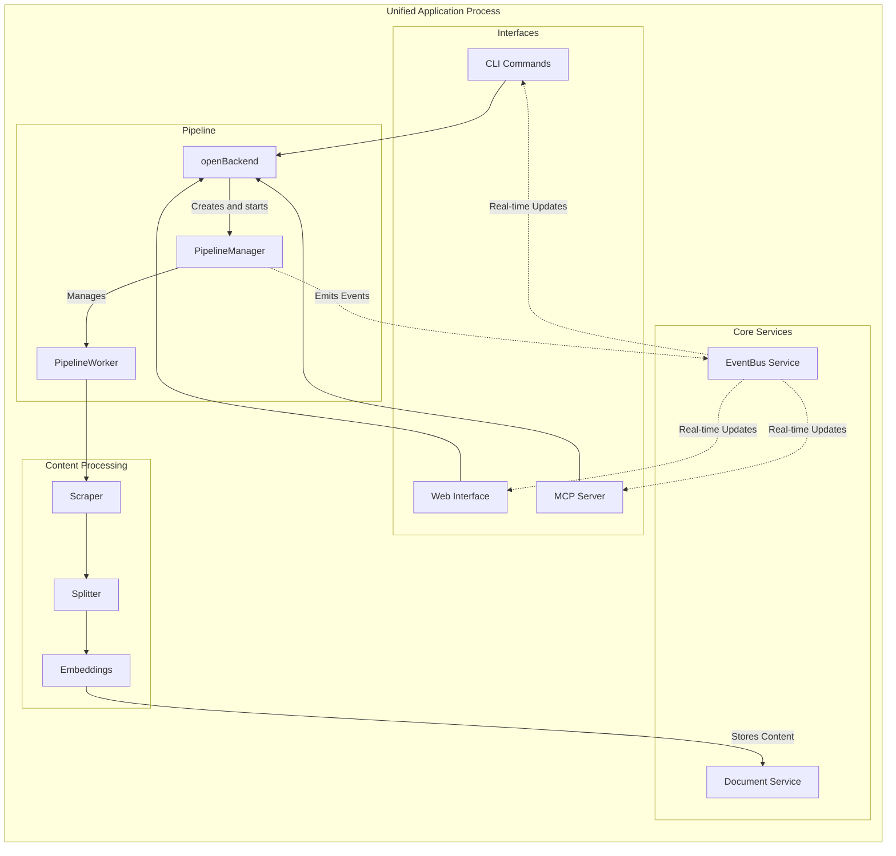
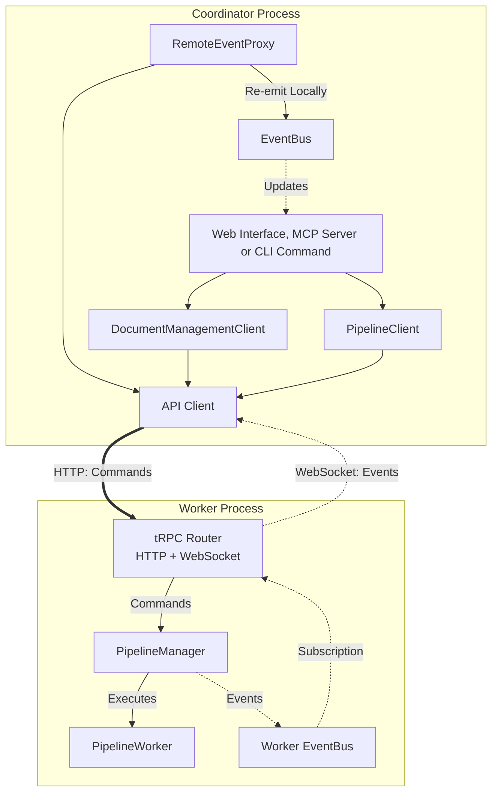

# Documentation MCP Server Architecture

## System Overview

The Documentation MCP Server indexes documentation from web sources, local files, and package registries, making it searchable via the Model Context Protocol (MCP). The system processes content into vector embeddings and provides search capabilities to AI coding assistants.

### Core Functions

- Documentation scraping from web, local files, npm/PyPI registries
- Semantic search using vector embeddings (OpenAI, Google, Azure, AWS providers)
- Version-specific documentation queries
- Asynchronous job processing with recovery
- Multiple access interfaces: CLI, MCP protocol, web UI

### Deployment Modes

The system runs in two modes:

**Unified Server**: Single process containing MCP server, web interface, and embedded worker. Default mode for development and simple deployments.

**Distributed Mode**: Separate coordinator and worker processes. Used for scaling processing workload across multiple containers.

Outside Docker, protocol selection is automatic - stdio transport for AI tools (no TTY), HTTP transport for interactive terminals (has TTY). The Docker image supplies environment defaults for HTTP on all container interfaces, overridable by runtime environment variables or CLI flags.

### Technology Stack

- Node.js 22.x, TypeScript, Vite build system
- Vitest for testing
- HTMX, AlpineJS, TailwindCSS for web interface
- LangChain.js for embeddings, Playwright for scraping
- SQLite with schema migrations

## Configuration System

Configuration resolves once per process via `loadConfig` in `src/utils/config.ts`. The system uses a strict **Zod schema** (`AppConfigSchema`) to validate and merge settings from four layers: Defaults < Config File (`config.yaml`) < Environment Variables < CLI Arguments.

**Loading Logic**:

- **Explicit Config (Read-Only)**: Files loaded via `--config` or `DOCS_MCP_CONFIG` are never modified by the server.
- **System Default (Read-Write)**: If no explicit config is provided, the server attempts to load from the system default path (e.g., `~/Library/Preferences/docs-mcp-server/config.yaml`). The server automatically updates this file with new defaults on startup.

All default values are unified in a single `DEFAULT_CONFIG` source of truth. The loading process ensures that the resulting `AppConfig` object is fully typed and validated before the application starts.

For detailed options and precedence rules, see [Configuration Concepts](docs/concepts/configuration.md).

### Directory Structure

```
src/
├── index.ts                         # Main entry point with CLI, protocol detection
├── app/                             # Unified server implementation
│   ├── AppServer.ts                 # Modular service composition
│   └── AppServerConfig.ts           # Service configuration interface
├── mcp/                             # MCP server implementation
│   ├── mcpServer.ts                 # MCP protocol server
│   ├── tools.ts                     # MCP tool definitions
│   └── startStdioServer.ts          # Stdio transport setup
├── pipeline/                        # Asynchronous job processing
│   ├── PipelineManager.ts           # Job queue and worker coordination
│   ├── PipelineClient.ts            # Pipeline on a remote worker, over the API client
│   ├── PipelineWorker.ts            # Individual job execution
│   └── trpc/                        # tRPC router for pipeline procedures
├── scraper/                         # Content acquisition and processing
│   ├── fetcher/                     # HTTP and file content fetching
│   ├── middleware/                  # Content transformation pipeline
│   ├── pipelines/                   # Content-type-specific processing
│   ├── strategies/                  # Source-specific scraping strategies
│   └── utils/                       # Scraping utilities
├── services/                        # Backend factory, API client, service registration
├── splitter/                        # Document chunking and segmentation
│   ├── GreedySplitter.ts            # Universal size optimization
│   ├── SemanticMarkdownSplitter.ts  # Structure-aware markdown splitting
│   ├── JsonDocumentSplitter.ts      # Hierarchical JSON splitting
│   ├── TextDocumentSplitter.ts      # Line-based text/code splitting
│   └── splitters/                   # ContentSplitter implementations (deprecated)
├── store/                           # Data storage and retrieval
├── tools/                           # Business logic implementations
├── types/                           # Shared TypeScript interfaces
├── utils/                           # Common utilities
└── web/                             # Web interface implementation
```

## System Architecture

The system uses a layered architecture where interfaces delegate to shared tools, which coordinate pipeline operations for content processing and storage. The architecture supports two deployment modes with different event flow patterns.

### Unified Mode (Local In-Process)

In unified mode, all components run within a single process. The `PipelineManager` executes jobs directly and emits events to the local `EventBus`, which notifies all consumers in real-time.



**Key Characteristics:**

- Direct method calls between components
- Local event propagation via `EventBus`
- Immediate job status updates
- Simple deployment (single process)

### Distributed Mode (Hub & Spoke)

In distributed mode, the worker runs as a separate process. Coordinators (the web server, the MCP server over HTTP or stdio, and CLI commands given `--server-url`) reach the shared worker through the same application API the web UI uses. Each opens a remote backend: one typed API client for the worker URL, with `DocumentManagementClient` and `PipelineClient` calling its procedures over HTTP, and a `RemoteEventProxy` that subscribes to the worker's events over one WebSocket and re-emits them on the local `EventBus`. Consumers use the same interfaces and the same bus as in unified mode.



**Key Characteristics:**

- **Hub**: Shared worker process executes all jobs
- **Spokes**: Independent coordinator processes (Web, MCP, CLI)
- **Split-Link Communication**: HTTP for commands, WebSocket for events; the links come from `src/services/apiClient.ts`, which the web UI uses too
- **Event Bridging**: every remote backend that has a pipeline relays the worker's events; a command waits briefly for the stream before its first job, and when the stream returns after a drop, the relay emits `JOB_LIST_CHANGE` and `LIBRARY_CHANGE` so views refetch what they missed
- **Scalability**: Multiple coordinators can share one worker
- **Transparency**: Consumers use the same `EventBus` API regardless of mode

### Protocol Auto-Detection

The entry point resolves protocol based on TTY status:

- No TTY (stdin/stdout redirected): stdio transport for direct MCP communication
- Has TTY (interactive terminal): HTTP transport with Server-Sent Events
- Manual override: `--protocol stdio|http` bypasses detection

The Docker image sets `DOCS_MCP_PROTOCOL=http` and `HOST=0.0.0.0`, so no-argument container startup serves HTTP even without a TTY. These lower-precedence aliases enter the existing environment configuration layer; unrelated CLI options preserve them, while runtime aliases, generic environment variables, and explicit CLI flags can override them. Docker stdio clients select `--protocol stdio` and keep stdin open with `docker run -i`.

CI builds and runs the production Docker image's E2E suite on native x86-64 and ARM64 Linux runners. Each architecture uses its own build cache. Release builds publish both architectures under the same image tag.

### Backend Selection

Every entry point opens its services with `openBackend()` (`src/services/backend.ts`), which decides local or remote from the worker URL and owns starting and stopping what it creates. Naming clarifies the mode: PipelineManager runs an in-process worker; PipelineClient uses an out-of-process worker.

- `serverUrl` specified: a remote backend. Its API client's HTTP calls and its event WebSocket use the same worker URL, path included, so a worker behind a path-prefixed reverse proxy works.
- `jobs: false`: documents only, for read-only commands and the CLI `remove`; no pipeline, and no WebSocket to a worker. A remote store removes a version through the worker's `removeDocs`, which cancels the worker's job for it first
- `jobs: { interruptedJobs }`: a started PipelineManager locally, which recovers the jobs an earlier run left unfinished (`recover`), marks them failed (`fail`), or leaves them alone (`leave`); the worker's pipeline remotely. Server commands host the store and recover or fail them; `scrape` and `refresh` run only their own job and leave the rest to the server

## Core Components

### Tools Layer

Business logic resides in the tools layer to enable code reuse across interfaces. Tools operate on shared pipeline and storage services, eliminating interface-specific implementations. CLI commands, MCP endpoints, and web routes all delegate to the same tool implementations.

The tools layer includes:

- Document scraping with configuration persistence
- Semantic search across indexed content
- Library and version management
- Job lifecycle management (status, progress, cancellation)
- URL fetching and markdown conversion

### Pipeline Management

The pipeline system manages asynchronous job processing with persistent state and real-time event propagation:

**PipelineManager**: Coordinates job queue, concurrency limits, and state synchronization. Maintains write-through architecture where job state updates immediately persist to database. Emits events to `EventBus` for real-time status updates to all consumers.

**PipelineWorker**: Executes individual jobs, orchestrating content fetching, processing, and storage. Reports progress through callbacks to the manager, which are converted to events.

**PipelineClient**: Provides the PipelineManager interface for a remote worker by calling the worker's API. Before its first job it waits briefly for the event stream, so a job that starts at once does not lose its first events. `waitForJobCompletion` settles on a relayed `JOB_STATUS_CHANGE` or on the worker's `getJob` state, which it checks right away and then every 10 seconds while events arrive, or every second while they do not.

**RemoteEventProxy**: Bridges events from a remote worker to the local `EventBus` through one subscription on the backend's API client. The WebSocket client reconnects dropped connections; the proxy subscribes again when the subscription itself ends. Its live state backs the web server's `worker.connected` health field.

**EventBus**: Central pub/sub service that decouples event producers (PipelineManager) from consumers (CLI, Web UI, MCP). Enables real-time updates without direct coupling between components.

Job states progress through: QUEUED → RUNNING → COMPLETED/FAILED/CANCELLED, with a running job passing through CANCELLING until it stops writing. All state transitions persist to database and emit events, enabling both recovery after restart and real-time monitoring. See [Event Bus Architecture](docs/concepts/eventbus-architecture.md) for detailed event flow diagrams.

### Content Processing

Content processing follows a modular strategy-pipeline-splitter architecture:

1. **Scraper Strategies**: Handle different source types (web, local files, package registries)
2. **Content Fetchers**: Retrieve raw content from various sources (HTTP, filesystem, APIs)
3. **Processing Pipelines**: Transform content using middleware chains and content-type-specific logic
4. **Document Processing**: Extract text from binary documents (PDF, Office, EPUB, etc.) using Xberg
5. **Document Splitters**: Segment content into semantic chunks preserving document structure
6. **Size Optimization**: Apply universal chunk sizing for optimal embedding generation
7. **Embedders**: Generate vector embeddings using configured provider

The system uses a two-phase splitting approach: semantic splitting preserves document structure, followed by size optimization for embedding quality. See [Content Processing](docs/concepts/content-processing.md) for detailed processing flows.

Across all splitting strategies, `TextContentSplitter` enforces a fence-balance invariant: no chunk boundary may fall inside an open ` ``` ` or `~~~` fenced code block, even when the block is embedded in a list item, blockquote, or arbitrary wrapper. When honoring this invariant would force a chunk past `maxChunkSize`, the splitter accepts the oversize chunk (logging a warning) rather than break the fence — guaranteeing balanced fences for downstream renderers and LLM consumers.

For web sources, `WebScraperStrategy` performs an ingestion-time `llms.txt` probe during scrapes and refreshes. It checks the input URL's parent directory before the site root, parses curated Markdown links with `llmsTxtParser`, and adds accepted links to the BFS queue only after the depth-0 page establishes the canonical post-redirect scope base. Queue entries seeded this way carry `fromLlmsTxt`, which makes `processItem` try the spec-defined `.md` URL variant before fetching the original page.

HTTP and browser-backed web fetches default to `Accept: text/markdown, text/html;q=0.9, */*;q=0.8` unless the caller provides an explicit `Accept` header. Markdown MIME responses route directly to `MarkdownPipeline`; HTML continues through `HtmlPipeline`, and generic `text/plain` remains on the text fallback except for accepted llms.txt `.md` variants.

#### Browser lifecycle

A web scrape runs one headless Chromium. `WebScraperStrategy` creates a `ManagedBrowser` ([src/scraper/fetcher/ManagedBrowser.ts](src/scraper/fetcher/ManagedBrowser.ts)) and hands it to both users of a browser: `BrowserFetcher`, which `AutoDetectFetcher` falls back to when a plain HTTP request meets a challenge or an anti-bot block, and `HtmlPlaywrightMiddleware`, which renders HTML in `playwright` and `auto` scrape modes. Each page gets its own browser context, so pages share the process but not cookies or storage.

`ManagedBrowser` launches Chromium on first use and launches a new one after the old one exits, for example when the operating system kills it under memory pressure. Callers that need a browser at the same time share one launch. `BrowserFetcher` retries a page once on the new browser when Chromium dies while loading it, unless the fetch was aborted. `HtmlPlaywrightMiddleware` replaces the browser only when a page or context fails to close in time, since a stuck cleanup can leave Chromium unresponsive; a failed render alone keeps the browser, which other pages may be using. Closing the browser is bounded by `scraper.pageTimeoutMs` (navigation itself by `scraper.browserTimeoutMs`) and falls back to killing the process, by the process ID Chromium reports over CDP at launch.

A crawl that ends early, because an item failed or the job was cancelled, aborts the items still running and waits for them before it returns. `ScraperService` cleans up the strategy, and with it the browser, only after that, so no item is left using a closed browser or launching a new one that nobody closes. An aborted browser fetch closes its context, which ends a navigation in progress.

Playwright's headless shell is the default binary. Installs made with `playwright install --no-shell` have only the full Chromium build, and the launch falls back to it. `PLAYWRIGHT_CHROMIUM_EXECUTABLE_PATH` overrides both. When Playwright's full build is not installed, a system Chromium (`/usr/lib/chromium/chromium`, `/usr/bin/chromium` or `/usr/bin/chromium-browser`) is used if one exists.

#### Sub-resource blocklist

During Playwright-driven page rendering, `HtmlPlaywrightMiddleware` aborts requests to a small, hand-curated list of third-party hosts that pages commonly load but that never carry documentation content: analytics SDKs, session-replay agents, chat widgets, captcha runtimes, and social-embed runtime JS. The list lives in [src/scraper/middleware/subresourceBlocklist.ts](src/scraper/middleware/subresourceBlocklist.ts) and matches on hostname suffix (with a label boundary) plus an optional path prefix. Two categories are deliberately excluded: **advertising networks**, to avoid triggering anti-adblock detection on monetized sites, and **generic CDNs** (unpkg, jsDelivr, cdnjs), because pages legitimately fetch content-bearing libraries from them. The top-level navigation and any iframe document navigations are always exempt — the check short-circuits on Playwright's `resourceType === "document"`. The feature is governed by a single config flag, `scraper.skipKnownTrackers`, which defaults to `true`.

#### Unprocessable-content filtering

The crawler declines to download resources no content pipeline can read. What "can read" means is derived from the pipelines themselves — [src/scraper/pipelines/capability.ts](src/scraper/pipelines/capability.ts) builds a predicate by asking each pipeline's own `canProcess()` — so support for a format is declared in exactly one place. Adding a pipeline widens the crawler automatically; no second list needs updating.

Two gates consult that predicate:

- **Queue-time**, in `WebScraperStrategy`'s discovered-link filter. A MIME type is detected from the link's *pathname* (not its href, so a host like `example.zip` cannot resolve an archive type off its TLD) and the link is dropped before any request when the type names binary media — `image/*`, `video/*`, `audio/*`, `font/*` — that no pipeline claims. The binary-media condition is what makes an extension trustworthy enough to act on without asking the server: `application/*` is deliberately excluded, because the `mime` package files plain-text scripts there (`.csh`, `.tcl`, `.bat`, `.scm`, `.ps` all resolve to `application/*` types that pipelines read fine).
- **Fetch-time**, in `HttpFetcher`. Responses are streamed, so the `Content-Type` is checked after redirect resolution and the access-policy check but before the body is read. A rejected response has its stream destroyed and is reported as `FetchStatus.SKIPPED`. This is the authoritative gate — it catches extensionless URLs and extensions that disagree with what the server actually serves.

A skipped resource is neither content nor a failure: it stores no page and is excluded from the child-page failure rate, so an asset-heavy site cannot trip `scraper.abortOnFailureRate`. Skips are logged at `debug` only.

There is no configuration flag. The fetch-time gate applies the same predicate the pipeline-selection loop already applies, just earlier, so disabling it would produce a byte-identical index more slowly. On the reference crawl used for issue #490 the two gates cut HTTP requests from 2158 to 1013 and removed roughly 265 MB of discarded image downloads, while indexing exactly the same 806 documents.

### Storage Architecture

SQLite database with normalized schema:

- `libraries`: Library metadata and organization
- `versions`: Version tracking with indexing status and configuration
- `pages`: Page-level metadata (URL, title, ETag, content type, crawl depth)
- `documents`: Content chunks with embeddings and metadata

The `versions` table serves as the job state hub, storing progress, errors, and scraper configuration for reproducible re-indexing.

DocumentManagementService handles CRUD operations and version resolution. DocumentRetrieverService provides hybrid search combining vector similarity and full-text search using Reciprocal Rank Fusion (RRF) with configurable weights. The search system implements dual-mode FTS query generation for improved recall (combining exact phrase and keyword matching) and uses an overfetch factor to retrieve more candidates before final ranking.

## Interface Implementations

### Web Interface

Server-side rendered application using Fastify with JSX components. HTMX provides dynamic updates without client-side JavaScript frameworks. AlpineJS handles client-side interactivity within components.

Routes delegate to tools layer for data operations. Components poll for job status updates every 3 seconds, displaying progress bars and status changes in real-time.

HTMX and AlpineJS integration uses custom events to decouple component interactions from global HTMX state.

### MCP Protocol Integration

The MCP server exposes tools as protocol-compliant endpoints, built on the MCP TypeScript SDK v2. Two transports are supported:

- **stdio transport**: For command-line integration and AI tools. Serves clients on protocol revision 2026-07-28 and on earlier, handshake-based revisions.
- **HTTP transport**: Streamable HTTP at `/mcp`, for protocol revision 2026-07-28 and, statelessly, for clients on earlier handshake-based revisions. The SDK's per-request handler is mounted on the application's Fastify route. Before it, the route checks the browser `Origin`, answers CORS preflights and non-POST methods, and verifies bearer tokens when authentication is enabled.
- **Host check**: a global hook refuses (`403`) every request and WebSocket upgrade whose `Host` names an unknown host, which stops DNS rebinding. Accepted are IP literals, `localhost`, single-label names, the public URL's host and the hosts of `server.allowedOrigins` (`createHostPolicy` in `src/app/originPolicy.ts`).
- **Deprecated HTTP+SSE transport**: `GET /sse` and `POST /messages`, registered only while authentication is off, for handshake-era clients. It uses the SDK's frozen `SSEServerTransport` from `@modelcontextprotocol/server-legacy`, with one MCP server instance per stream, and goes away in a future major release.

Protocol selection defaults to TTY-based auto-detection outside Docker. The Docker image defaults to HTTP on all container interfaces; runtime environment variables and CLI flags can override it.

When authentication is enabled, the HTTP transport acts as an OAuth 2.0 resource server. It publishes protected resource metadata and accepts only JWTs the configured identity provider issued for its public URL; see [Authentication](docs/infrastructure/authentication.md).

All advertised URLs derive from one resolved public location (`server.publicUrl`). The server answers every route with or without that URL's path prefix, so it runs behind reverse proxies that strip the prefix or forward it; see [Reverse Proxy Deployment](docs/infrastructure/reverse-proxy.md).

Available MCP tools mirror CLI functionality: document scraping, search, library management, and job control. Tools maintain identical interfaces across CLI and MCP access methods.

During initialization the server sends instructions that clients add to the model's context. Tool descriptions explain one tool each; the instructions explain how the tools work together. Configured instructions (`server.instructions` or `server.instructionsFile`) replace the built-in text entirely. The built-in text depends on read-only mode and names only the tools registered in that mode.

### Configuration and Deployment

Configuration uses environment variables with sensible defaults. Database location auto-detects project-local storage or system application directory.

The AppServer provides modular service composition, enabling selective feature activation based on deployment requirements.

## Development Guidelines

### Code Organization

- Tools implement business logic with interface-agnostic design
- Pipeline components handle asynchronous processing concerns
- Storage layer abstracts database operations with migration support
- Interfaces delegate to tools rather than implementing logic directly

### Testing Strategy

Tests focus on public API behavior and observable side effects. Mock only external dependencies (databases, APIs, filesystem). Tests should remain stable across refactoring by avoiding implementation detail assertions.

### Logging

Hierarchical logging strategy:

- Tools layer: User-facing operations and results
- Core components: Operational status and state changes
- Processing layer: Detailed progress and error conditions

Use `console.*` for direct user output, `logger.*` for application events.

### Error Handling

Errors propagate through the tools layer with context preservation. Job failures store detailed error information for debugging and user feedback.

## Architectural Patterns

### Write-Through Architecture

Pipeline jobs serve as single source of truth, containing both runtime state and database fields. All updates immediately synchronize to database, ensuring consistency and recovery capability.

### Functionality-Based Design

Components are selected based on capability requirements rather than deployment context. `openBackend()` chooses implementations based on desired functionality (embedded vs external, documents only vs jobs, recovery vs immediate).

### Protocol Abstraction

Transport layer abstracts stdio vs HTTP differences, enabling identical tool functionality across access methods.

## Extension Points

New functionality should follow established patterns:

- Implement core logic in tools layer for interface reuse
- Add pipeline workers for new content processing types
- Extend scraper middleware for additional content sources
- Use migration system for schema changes

## References

Detailed documentation for specific architectural areas:

### Concepts

- [Event Bus Architecture](docs/concepts/eventbus-architecture.md) - Event-driven architecture and real-time updates
- [Pipeline Architecture](docs/concepts/pipeline-architecture.md) - Job processing and worker coordination
- [Content Processing](docs/concepts/content-processing.md) - Scraping and document processing
- [Supported Formats](docs/concepts/supported-formats.md) - File format reference and pipeline routing
- [Data Storage](docs/concepts/data-storage.md) - Database design and embedding management
- [Refresh Architecture](docs/concepts/refresh-architecture.md) - Efficient re-indexing with change detection
- [Splitter Hierarchy](docs/concepts/splitter-hierarchy.md) - Document chunk organization and hierarchy
- [Search Result Reassembly](docs/concepts/search-result-reassembly.md) - Search result processing and assembly
- [Source Code Splitter](docs/concepts/source-code-splitter.md) - Source code chunking strategies
- [Content Agnostic Assembly](docs/concepts/content-agnostic-assembly.md) - Content assembly patterns

### Infrastructure

- [Deployment Modes](docs/infrastructure/deployment-modes.md) - Protocol detection and server modes
- [Authentication](docs/infrastructure/authentication.md) - OAuth 2.0 resource-server authentication for the MCP endpoint
- [Reverse Proxy Deployment](docs/infrastructure/reverse-proxy.md) - Serving under a public URL and path behind nginx or Traefik
- [Telemetry](docs/infrastructure/telemetry.md) - Privacy-first telemetry architecture

## Benchmarking

The retrieval quality of `SearchTool` is measured by the search-quality benchmark.
It produces deterministic IR metrics (MRR, Recall@k, nDCG@k, Hit@k) against a
labelled qrel dataset, plus LLM-judged chunk-coherence / faithfulness / answerability
scores. Scope is retrieval-only — end-to-end RAG generation is intentionally
out of scope.

Headline metrics gate regressions against a checked-in baseline; LLM-judged scores
are observational. The benchmark runs on `workflow_dispatch` and a weekly schedule
and is not wired into PR-required checks.

- **Operator guide:** [docs/guides/benchmarking.md](docs/guides/benchmarking.md) — prerequisites, how to run, how to interpret results.
- **Developer internals:** [tests/search-eval/README.md](tests/search-eval/README.md) — file layout and extension points.

#### Scrape progress counters

A scrape reports four counters. `totalDiscovered` counts URLs admitted to the
queue; `totalPages` is how many items the job expects to process; `pagesScraped`
counts items dequeued and given an outcome; `pagesIndexed` counts those that
produced stored content. The first two move at enqueue, the last two at outcome.

`pagesScraped` converges on `totalPages` because every queued item reaches
exactly one outcome — depth, scope, patterns and content type are all filtered
before admission, so nothing is queued and then silently discarded. `maxPages`
bounds `pagesIndexed` rather than attempts, so asking for 100 pages yields 100
pages; the denominator stretches by the number of items that produced nothing,
which keeps the fraction able to complete.

Every event names its outcome — stored, unchanged, absent, empty, skipped or
failed. This matters most for the two that both arrive without content: a `304`
is unchanged and the stored page is kept, while an empty `200` means the page
exists and holds nothing, and its stored content is replaced. When a pipeline
*errors* while producing nothing we have learned nothing about the page, so the
previous content is left alone and the response validator withheld, which keeps
the next refresh unconditional instead of caching a failure forever.
