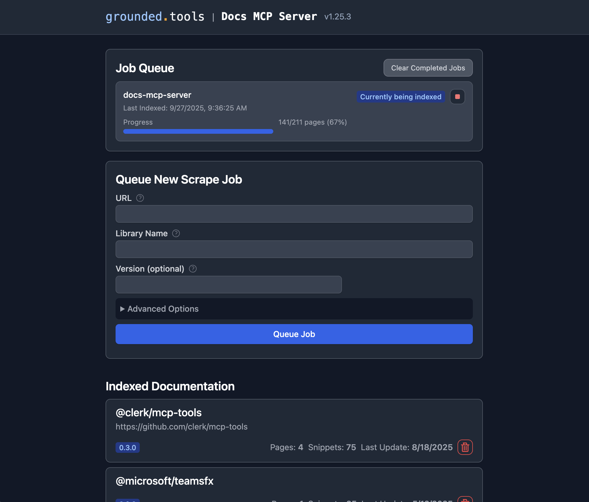

# Grounded Docs MCP Server

Grounded Docs gives your AI coding assistant a documentation index that matches the library versions you use. It fetches documentation from websites, GitHub repositories, npm, PyPI and local folders, and serves search over the Model Context Protocol (MCP), a command line and a web UI. Your assistant answers from that documentation instead of from what it remembers.

It is an open-source alternative to Context7, Nia and Ref.Tools.



## Features

- Indexes websites, GitHub repositories, npm and PyPI packages, local folders and archives (ZIP, TAR).
- Reads HTML, Markdown, PDF, Office and OpenDocument files, EPUB, Jupyter notebooks, source code and more. See [Supported Formats](docs/concepts/supported-formats.md).
- Stores each library version separately, so a search targets the version your project uses.
- Combines full-text search with optional vector search through OpenAI, Ollama, Gemini, Vertex AI, AWS Bedrock, Azure OpenAI or any OpenAI-compatible server.
- Runs on your machine and keeps its index in a local SQLite database. Document text goes only to the embedding provider you configure; with a local one, such as Ollama, it stays on your machine. Usage telemetry is on by default; [Telemetry](docs/infrastructure/telemetry.md) lists what it sends and how to turn it off.
- Works with any MCP client, over stdio or Streamable HTTP. HTTP MCP requests require an access token.
- Tracks local tool usage with compact recent metadata and durable daily counters. The Statistics page shows usage by caller, tool and library.

## Quick Start

You need Node.js 22 or later, or Docker. [Installation](docs/setup/installation.md) covers both in detail, along with Docker Compose and running the server inside your AI client.

### 1. Start the server

Set `DOCS_MCP_ADMIN_TOKEN` to a long random operator key before starting the HTTP server. This key unlocks client-token management and usage statistics in the web UI.

```bash
npx @arabold/docs-mcp-server@latest
```

Or with Docker:

```bash
docker run --rm \
  -v docs-mcp-data:/data \
  -v docs-mcp-config:/config \
  -p 6280:6280 \
  ghcr.io/arabold/docs-mcp-server:latest
```

### 2. Turn on vector search (optional)

Without an embedding model, search uses full-text matching. Vector search also finds passages by meaning. To use OpenAI, start the server with `OPENAI_API_KEY` set:

```bash
OPENAI_API_KEY="sk-proj-..." npx @arabold/docs-mcp-server@latest
```

With Docker, add `-e OPENAI_API_KEY="sk-proj-..."`. [Embedding Models](docs/guides/embedding-models.md) covers Ollama, Gemini, Azure OpenAI and other providers.

Do this before you add documentation. Embeddings are computed when a page is indexed, so documentation indexed without a model gets no vectors until you scrape it again with `--replace`.

### 3. Create an MCP access token

Set `DOCS_MCP_ADMIN_TOKEN` to a long random operator key in the server's environment, or set `auth.adminToken` in its configuration. In **Settings**, unlock MCP administration with that key and create a client token with a comment identifying its recipient. The operator key is separate from client tokens. [Authentication](docs/infrastructure/authentication.md) describes both access modes.

### 4. Add documentation

Open the web UI at [http://localhost:6280](http://localhost:6280) and choose **Add library**.

### 5. Connect your AI client

Add the server's MCP endpoint, `http://localhost:6280/mcp`, to your client. Most clients accept an entry like this:

```json
{
  "mcpServers": {
    "docs-mcp-server": {
      "url": "http://localhost:6280/mcp",
      "headers": { "Authorization": "Bearer <YOUR_MCP_TOKEN>" }
    }
  }
}
```

[Connecting MCP Clients](docs/guides/mcp-clients.md) has the exact settings for Claude Code, Claude Desktop, Zed and other clients, how a client can start the server itself over stdio, and the list of MCP tools.

## Command Line

The CLI indexes and searches without a running server, which suits scripts and coding agents. It shares its database with a server on the same machine.

```bash
# Index documentation
npx @arabold/docs-mcp-server@latest scrape react https://react.dev/reference/react

# Search it
npx @arabold/docs-mcp-server@latest search react "useEffect cleanup" --output yaml

# Fetch one page as Markdown without indexing it
npx @arabold/docs-mcp-server@latest fetch-url https://react.dev/reference/react/useEffect
```

`scrape` refuses a library version that already exists. Pass `--replace` to rebuild it, or run `refresh` to update it in place. The [`skills/`](skills/) directory has Agent Skills that teach coding agents these commands. [Basic Usage](docs/guides/basic-usage.md) covers every command, output formats and local files.

## Web Scraping

- Before it crawls a website, a scrape or refresh looks for an `llms.txt` file in the start URL's directory and at the site root. The links listed there become extra starting points, and for those pages the scraper first tries the Markdown version of the URL, such as `/guide/index.html.md` or `/page.html.md`.
- Requests ask for HTML first, like a browser. Markdown that a server converts on request leaves out the site's navigation, so a crawl would miss most pages. The scraper uses Markdown where the site publishes it: pages listed in `llms.txt` and links to `.md` files. A custom `Accept` header replaces the default one.
- For documentation sites that route with hash URLs, such as `https://docs.example.com/#/guide`, turn on hash routes for the scrape. See [Hash Route Behavior](docs/setup/configuration.md#hash-route-behavior).

## Documentation

Setup:

- [Installation](docs/setup/installation.md): npx, Docker, Docker Compose and the embedded server.
- [Configuration](docs/setup/configuration.md): config file, environment variables and every setting.
- [Embedding Models](docs/guides/embedding-models.md): providers, models and changing the model.

Usage:

- [Basic Usage](docs/guides/basic-usage.md): the web UI, the CLI and local files.
- [Connecting MCP Clients](docs/guides/mcp-clients.md): client settings and MCP tools.
- [Supported Formats](docs/concepts/supported-formats.md): file formats and how each is processed.
- [Search Quality Benchmark](docs/guides/benchmarking.md): measure retrieval quality.

Deployment:

- [Deployment Modes](docs/infrastructure/deployment-modes.md): one process, or a worker with separate MCP and web services.
- [Reverse Proxy Deployment](docs/infrastructure/reverse-proxy.md): serve the server under a path such as `https://example.com/docs`.
- [Authentication](docs/infrastructure/authentication.md): client access tokens, administrative access and optional OAuth2/OIDC.
- [MCP Statistics](docs/guides/mcp-statistics.md): usage history, filters and retention.
- [Security](docs/infrastructure/security.md): trust boundaries and limits on what the scraper may reach.
- [Telemetry](docs/infrastructure/telemetry.md): the usage events the server sends, and how to turn them off.

Internals:

- [Architecture](ARCHITECTURE.md): system design for contributors.

## Contributing

See [CONTRIBUTING.md](CONTRIBUTING.md) for development setup and guidelines.

## License

This project is licensed under the MIT License. See [LICENSE](LICENSE) for details.
