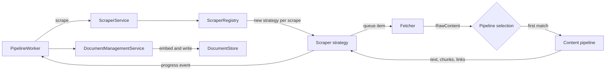
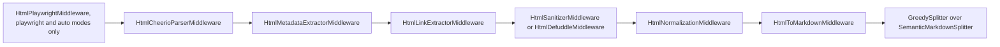

# Content Processing

Content processing turns a documentation source into chunks ready to embed. A scraper strategy walks the source, a fetcher retrieves each item, a content pipeline turns the raw bytes into text and chunks, and the pipeline worker stores the result.

[ARCHITECTURE.md](../../ARCHITECTURE.md#content-processing) gives the overview. It also covers the [browser lifecycle](../../ARCHITECTURE.md#browser-lifecycle), the [sub-resource blocklist](../../ARCHITECTURE.md#sub-resource-blocklist), [unprocessable-content filtering](../../ARCHITECTURE.md#unprocessable-content-filtering), `llms.txt` probing and the `Accept` header. This document describes how the parts fit together and why they are divided the way they are. [Supported Formats](supported-formats.md) lists which formats each pipeline reads.

## Flow

The links a pipeline finds go back to the strategy, which decides which of them to queue.

## Scraper strategies

`ScraperRegistry` ([src/scraper/ScraperRegistry.ts](../../src/scraper/ScraperRegistry.ts)) picks a strategy from the URL and creates a new instance for every scrape, so parallel jobs share no crawl state. `ScraperService` runs the strategy and cleans it up when the scrape ends.

`BaseScraperStrategy` owns the crawl: the queue, deduplication, scope and pattern checks, concurrency, the page limit, progress counters and the failure-rate abort. A subclass implements `processItem`, which turns one queue item into a result.

- `WebScraperStrategy` crawls HTTP and HTTPS sites. When the start URL is an archive, it downloads the archive and hands it to `LocalFileStrategy`.
- `LocalFileStrategy` walks `file://` directories and opens archives it meets as containers of more files.
- `GitHubScraperStrategy` lists a repository's files through the GitHub API, keeps the ones its extension filter accepts, and fetches each from `raw.githubusercontent.com`. `GitHubRepoProcessor` handles repository files and `GitHubWikiProcessor` handles wiki pages.
- `NpmScraperStrategy` and `PyPiScraperStrategy` wrap a `WebScraperStrategy` that also strips query strings from package-page URLs.

Every strategy builds its pipelines with `PipelineFactory.createStandardPipelines()` and selects among them the same way, so a format reads the same whatever its source. `FetchUrlTool` uses the same pipelines to convert a single URL.

## Fetchers

A fetcher returns `RawContent`: the bytes, the MIME type and charset, and the `ETag` and `Last-Modified` values a refresh sends back (see [Refresh Architecture](refresh-architecture.md)).

- `HttpFetcher` makes plain HTTP requests with retries. It follows redirects itself so it can check every hop against the access policy.
- `BrowserFetcher` loads the page in Chromium.
- `AutoDetectFetcher` routes by URL scheme and falls back from `HttpFetcher` to `BrowserFetcher` when a request meets a challenge, a TLS certificate failure, or a 403 or 429 response. `WebScraperStrategy` uses it.
- `FileFetcher` reads local files and takes the MIME type from the file extension.

## Content pipelines

A pipeline ([src/scraper/pipelines/](../../src/scraper/pipelines/)) does two jobs: it converts raw content into text, and it splits that text into chunks. Splitting lives in the pipeline so each content type can use the splitter that understands its structure.

The strategy tries the pipelines in a fixed order and uses the first whose `canProcess()` accepts the item's MIME type. Content that no pipeline accepts is skipped. The same `canProcess()` methods decide what a web crawl downloads at all, so support for a format is declared in one place.

The HTML and Markdown pipelines preprocess content with a middleware chain (`BasePipeline.executeMiddlewareStack`). Each middleware reads and updates a shared `MiddlewareContext` (content, title, links, errors) and calls the next one. An error that a middleware throws goes into the context's `errors` instead of stopping the pipeline, and the pipeline splits whatever content is left. `WebScraperStrategy` treats a run that produced errors and no text as a failed extraction, not an empty page, so the stored page survives it (see [Scrape progress counters](../../ARCHITECTURE.md#scrape-progress-counters)).

### HTML

`HtmlPipeline` decodes the bytes with the charset the page's `<meta>` tag declares, or else the one in the response header, runs the middleware chain below, and splits the resulting Markdown.

- Rendering comes first and runs only in the `playwright` and `auto` scrape modes. GitHub repository files always use `fetch` mode, since a raw file's scripts and styles are not served next to it. GitHub wiki pages use `fetch` mode too.
- The title and the links come from the whole page, before extraction. The title is the `<title>` text, or the first `<h1>` when that is empty. Links in navigation and sidebars still reach the crawler, even though extraction removes their text from the indexed content.
- Extraction removes page chrome. `scraper.htmlExtractor` selects the extractor. The default, `cheerio`, runs `HtmlSanitizerMiddleware`: it removes known chrome by selector, plus any `excludeSelectors` from the scrape options, and then narrows the page to its `<main>` or `role="main"` region when that region holds most of the remaining text. This catches site-specific promo banners and sponsor blocks that no selector list can name. `defuddle` runs `HtmlDefuddleMiddleware`, which the pipeline imports only on first use, so the default path never loads Defuddle and its dependencies.
- Normalization works on what remains. It makes relative link and image URLs absolute, and unwraps fragment-only and non-HTTP links (`javascript:`, `mailto:`) to their text.
- `HtmlToMarkdownMiddleware` converts the cleaned DOM to Markdown with Turndown, so HTML pages and Markdown files share one splitter.

### Markdown

`MarkdownPipeline` takes the title from the front matter `title` field, or else from the first `#` heading. It collects inline and reference-style link targets for the crawler and splits the text with the same splitters as HTML. A site that serves Markdown, through content negotiation or a `.md` variant, skips the HTML chain entirely.

### Documents

`DocumentPipeline` passes PDF, Office, OpenDocument, RTF, EPUB, FictionBook and Jupyter files to [Xberg](https://github.com/xberg-io/xberg), which renders them as Markdown. From there they split like Markdown. [Supported Formats](supported-formats.md#documents) covers the size limit and the title.

### JSON

`JsonPipeline` runs no middleware. It takes the title from a top-level `title`, `name`, `displayName` or `label` string. `JsonDocumentSplitter` emits a chunk for each structural piece of the document, such as an opening brace, a property or an array element, with a path built from the keys. The pieces are designed so that, joined in order, they form valid JSON again. A value nested deeper than `splitter.json.maxNestingDepth` stays one serialized chunk at its path instead of being broken down further. A document that would yield more than `splitter.json.maxChunks` chunks falls back to plain text splitting, and content that does not parse becomes a single chunk.

### Source code

`SourceCodePipeline` runs no middleware and splits with `TreesitterSourceCodeSplitter`. [Source Code Splitter](source-code-splitter.md) describes it.

### Plain text

`TextPipeline` is the fallback for any other `text/*` content, and refuses content that contains a null byte. `TextDocumentSplitter` cuts the text at paragraphs, then lines, then words.

## Two-phase splitting

Splitting has two phases. The first follows the structure of the content type: headings for Markdown, keys for JSON, declarations for source code, paragraphs and lines for plain text. `SemanticMarkdownSplitter` also keeps code blocks, tables and lists whole where it can, and splits them with type-aware splitters where it cannot. Every chunk carries a section `level` and `path`; [Splitter Hierarchy](splitter-hierarchy.md) describes them, including how merging combines paths.

The second phase, `GreedySplitter`, merges small neighboring chunks toward `splitter.preferredChunkSize`, never merges past `splitter.maxChunkSize`, and keeps a break before an H1 or H2 section once the current chunk reaches `splitter.minChunkSize`. [Configuration](../setup/configuration.md#splitter-splitter) describes the three settings.

| Pipeline | First phase | Second phase |
|:---------|:------------|:-------------|
| `HtmlPipeline`, `MarkdownPipeline`, `DocumentPipeline` | `SemanticMarkdownSplitter` | `GreedySplitter` |
| `TextPipeline` | `TextDocumentSplitter` | `GreedySplitter` |
| `JsonPipeline` | `JsonDocumentSplitter` | none |
| `SourceCodePipeline` | `TreesitterSourceCodeSplitter` | none |

JSON and source code skip the second phase on purpose. Their chunks are structural units that `HierarchicalAssemblyStrategy` puts back together at search time, for example the whole class around a matched method, and merging neighbors would blur those units. [Search Result Reassembly](search-result-reassembly.md) describes how.

The splitters cut anything larger than `maxChunkSize`, with two exceptions. `TextContentSplitter` never cuts inside a fenced code block and accepts an oversize chunk instead, as the fence-balance note in [ARCHITECTURE.md](../../ARCHITECTURE.md#content-processing) describes. JSON that does not parse stays one chunk.

## Storage

The worker passes each result to `DocumentManagementService.addScrapeResult`, and `DocumentStore.addDocuments` embeds and writes the chunks. Before embedding, the store puts a short header with the page title, URL and section path in front of each chunk's text. The header does not count against `maxChunkSize`. [Data Storage](data-storage.md) covers the schema, and [Search Result Reassembly](search-result-reassembly.md) covers how stored chunks become search results.
