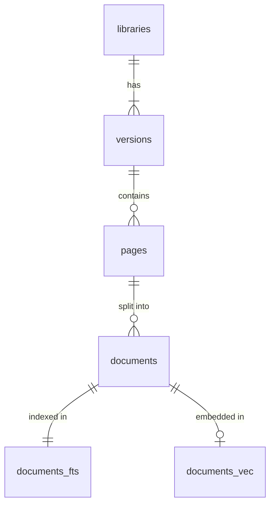

# Data Storage

All indexed documentation lives in one SQLite database file, `documents.db`, opened with better-sqlite3 and the sqlite-vec extension. `DocumentStore` ([src/store/DocumentStore.ts](../../src/store/DocumentStore.ts)) owns the SQL. `DocumentManagementService` ([src/store/DocumentManagementService.ts](../../src/store/DocumentManagementService.ts)) wraps it for the rest of the application: version resolution, page reads, removal, and the events that tell views the stored documentation changed.

The schema is defined by the migrations in [db/migrations/](../../db/migrations/). Read them for tables, columns, indexes and triggers.

## Location

`resolveStorePath` ([src/utils/paths.ts](../../src/utils/paths.ts)) picks the directory. The `--store-path` option or `DOCS_MCP_STORE_PATH` wins when set. Otherwise a `.store/` directory in the project root is used if it already holds a database, which is the legacy location. Otherwise the store goes to the operating system's data directory for `docs-mcp-server`, for example `~/Library/Application Support/docs-mcp-server/` on macOS.

## Data model

A library has versions, a version has pages, and a page has chunks, stored in the `documents` table. Two search indexes follow the chunks. A separate key-value table, `metadata`, records the embedding model.

### Libraries and versions

A library's `name` is its lookup key: the name as entered, trimmed and lowercased, so `React` and ` react ` reach the same library. `display_name` keeps the name as first entered, trimmed only, and is what users see. Names are opaque; no character in them carries meaning. A library exists only while it has a version. Creating a library inserts its first version in the same transaction, and removing its last version removes the library.

Version labels are trimmed and lowercased too (`normalizeVersionLabel` in [src/store/types.ts](../../src/store/types.ts)). The empty label holds unversioned documentation. Labels are otherwise kept as given, so `stable` is as valid as `1.2.0`. Matching a requested version to a stored label is `DocumentManagementService.findBestVersion`'s job; the [version-resolution spec](../../openspec/specs/version-resolution/spec.md) has the rules.

`DocumentStore.claimVersion` creates or claims a library and version in one transaction and applies the caller's policy for an existing target (`ExistingTargetPolicy`): fail when the version exists, fail when the library exists (the web UI's "Add library"), or replace.

A version row is also the durable record of its indexing job. [Pipeline Architecture](pipeline-architecture.md#jobs-and-versions) describes how the pipeline keeps it current.

### Pages

There is one page row per URL per version. It holds what a refresh needs to ask whether the page changed: ETag, Last-Modified and crawl depth. It records the content type before and after processing (`source_content_type` and `content_type`), so a PDF stored as Markdown keeps both. When the content came from a different location than the URL the page is recorded under, `content_url` names that location. [Refresh Architecture](refresh-architecture.md) covers how a refresh uses these fields.

### Chunks

A chunk row holds the chunk's text, its position in the page (`sort_order`, starting at 0), JSON metadata with its `level`, `path` and `types`, and its embedding as a float32 blob. [Splitter Hierarchy](splitter-hierarchy.md) explains the metadata.

## Writing a page

`DocumentStore.addDocuments` writes one page at a time. When vector search is enabled, it computes the embeddings first, outside any transaction, so slow provider calls never hold the write lock. Each chunk is embedded together with a short header naming the page title, URL and section path, which gives the vector context the chunk text lacks. One transaction then writes the page row, validators included, and replaces the page's previous chunks with the new ones, so a stored ETag always describes the stored content.

A page that exists but yields no text is recorded without chunks (`addEmptyPage`), which clears what it held before.

## Search indexes

Triggers on `documents` keep both indexes in step with the chunks, so code that writes chunks never touches the indexes directly.

- `documents_fts` is an FTS5 table over chunk text, page title, page URL and section path, using the Porter stemmer over the `unicode61` tokenizer. It keeps its own copy of the text.
- `documents_vec` is a sqlite-vec table with each chunk's embedding. It is partitioned by library and version, so a nearest-neighbour query reads only the version being searched.

The vector table's dimension is fixed when the table is created. On startup `DocumentStore.ensureVectorTable` rebuilds the table when the dimension or the partition columns differ from what the store needs. It keeps vectors of the right dimension and fills in the rest from the embeddings stored with the chunks.

## Search

`DocumentStore.findByContent` finds the chunks that match a query within one library version. With vector search enabled, it runs a full-text query and a nearest-neighbour query and fuses the two rankings with Reciprocal Rank Fusion. Both sides fetch more candidates than requested (`search.overfetchFactor`, with `search.vectorMultiplier` widening the vector side), and `search.weightVec` and `search.weightFts` weight the two rankings. Without vector search, BM25 ranks the full-text matches alone. The full-text query matches the whole input as a phrase or any of its terms, and quoted text stays one term.

Chunks typed `structural`, the opening lines of a class or similar declaration, are never returned as matches. They appear only as context around other matches. [Search Result Reassembly](search-result-reassembly.md) describes how matches become results, and the [hybrid-search spec](../../openspec/specs/hybrid-search/spec.md) has the ranking requirements.

## Embedding model identity

Vectors from different models cannot be compared, so the `metadata` table records the embedding model and dimension the stored vectors were made with. Unless `embeddings.vectorDimension` is set explicitly, the dimension is the model's own: a known value, or the length of a probe vector on first use, and the stored value on later starts. Vectors shorter than the table's dimension are padded with zeros.

On startup `DocumentStore.checkEmbeddingModelChange` compares the configured model and dimension with the stored ones, and on a mismatch the store refuses to open. The default command and `mcp` first ask for confirmation when they run in an interactive terminal (`handleEmbeddingModelChange` in [src/cli/utils.ts](../../src/cli/utils.ts)). Confirming clears every stored vector and recreates the vector table. Full-text search keeps working, and a library has vectors again once it is scraped again.

[Embedding Models](../guides/embedding-models.md) covers providers and model names. The [embedding-model-change-safety spec](../../openspec/specs/embedding-model-change-safety/spec.md) has the requirements.

## Migrations

`applyMigrations` ([src/store/applyMigrations.ts](../../src/store/applyMigrations.ts)) runs on every start. It applies the files in `db/migrations/` that `_schema_migrations` does not list yet, in file-name order, inside one IMMEDIATE transaction, and retries while another process holds the database. A file can divide itself into labelled steps with `-- @migration-step <label>` lines, and each step is logged with its duration. After applying migrations it runs `VACUUM`.

Migrations only go forward. Returning to an older release means restoring a backup taken before the upgrade.

Migrations run with SQLite's rollback journal, never with `journal_mode = OFF`. Destructive migrations drop and recreate tables and virtual tables, and if a later step fails, the rollback must restore the database as it was. Tuning that keeps rollback intact, such as cache size, memory mapping and `synchronous = NORMAL`, is applied during migrations. Afterwards the store switches to WAL mode with a bounded WAL file, a busy timeout and foreign keys.

Validate large or destructive migrations against a copy of important local databases before running them against the live store. Take the copy with SQLite's backup API or an application-level copy so it is consistent. Run the new version against the copy and check table counts and search results before migrating high-value data. The [database-migrations spec](../../openspec/specs/database-migrations/spec.md) has the requirements.

## Concurrent access

Several processes can open the same database, for example a server and a local CLI `scrape`. WAL mode lets readers continue while one connection writes. Writes are serialized; a writer that finds the database locked waits up to the busy timeout. Operations that read and then write, such as claiming or removing a version, run in IMMEDIATE transactions that take the write lock before they read.

## Disk space

SQLite does not shrink the database file when rows are deleted. Deleted rows become free pages, and in WAL mode the deletes are first written to `documents.db-wal`, so the files on disk can grow after a removal.

After a bulk delete (`removeVersion` and `removeAllDocuments`) the store runs a passive WAL checkpoint. It never waits on readers or writers, so search stays available. It does not shrink `documents.db`. Deleting a single page during a refresh does not checkpoint.

The `compact` command, also available against a remote worker with `--server-url`, reclaims the space. It first merges the full-text index, because FTS5 keeps deleted text in its index until a merge drops it. It then rewrites the file with `VACUUM`. `VACUUM` takes an exclusive lock and blocks readers, so run `compact` while the store is idle. SQLite's temporary copy of the database goes to disk rather than memory, which keeps memory use low but needs enough free disk space for that copy. In-memory databases skip compaction.
