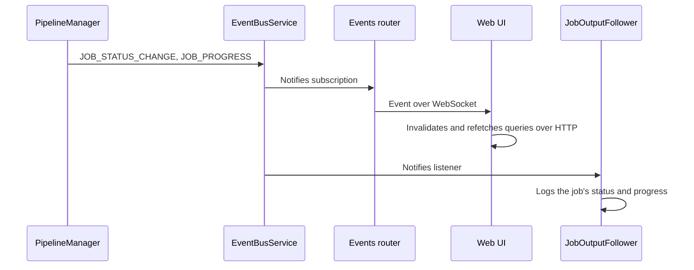
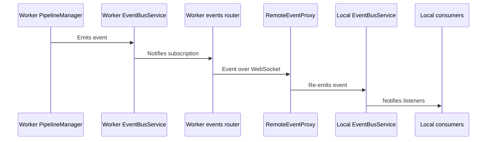

# Event Bus Architecture

Each process has one `EventBusService` ([src/events/EventBusService.ts](../../src/events/EventBusService.ts)), an in-memory publish/subscribe bus. The pipeline and the store publish what changed; the web UI, CLI commands, job waits and telemetry listen. Producers do not know who listens, and a consumer sees the same events whether a job runs in its own process or on a remote worker.

Events are notifications, not state. A consumer that needs the current state reads it: the web UI refetches its queries, and a wait for a remote job also asks the worker. A lost event therefore only delays an update.

## Events

[src/events/types.ts](../../src/events/types.ts) defines the event types and their payloads.

| Event | Emitted by | When |
|---|---|---|
| `JOB_STATUS_CHANGE` | `PipelineManager` | A job changes status. Carries the job. |
| `JOB_PROGRESS` | `PipelineManager` | A running job reports a page outcome. Carries the job and the progress report. |
| `LIBRARY_CHANGE` | `DocumentManagementService` | Indexed content may have changed: on every version status write, which every job status change makes, and when the store writes or deletes a page or removes a version. No payload. |
| `JOB_LIST_CHANGE` | `PipelineManager`, `RemoteEventProxy` | Finished jobs were cleared, or the relay from a worker is live again after a drop. No payload. |

## Consumers

- The events router ([src/events/trpc/router.ts](../../src/events/trpc/router.ts)) serves the `events.subscribe` subscription on the API's WebSocket. A subscriber names the event types it wants, or gets all of them. The web UI subscribes once in its app shell and invalidates the affected queries, which refetch over HTTP (`useLiveInvalidation` in [src/web/client/hooks/useLiveInvalidation.ts](../../src/web/client/hooks/useLiveInvalidation.ts)). A coordinator's `RemoteEventProxy` subscribes to its worker the same way.
- `JobOutputFollower` ([src/cli/JobOutputFollower.ts](../../src/cli/JobOutputFollower.ts)) passes `scrape` and `refresh` the status and progress of the job they submitted, which they log. A shared worker reports other clients' jobs too, and a job can report before the command knows its id. The follower therefore subscribes before the job is submitted, buffers what arrives, and replays that job's events once it has the id.
- `PipelineClient.waitForJobCompletion` listens for its job's `JOB_STATUS_CHANGE`.
- `TelemetryService` ([src/telemetry/TelemetryService.ts](../../src/telemetry/TelemetryService.ts)) reports job events. A local backend starts it together with its pipeline, so only the process that runs a job reports it, and relayed copies are not reported again.

## Local Event Flow

When a job runs in the same process, its events reach the listeners directly. Which listeners exist depends on the process: a server has the events router, and a CLI command has its follower.

## External Worker Event Flow

A process whose backend uses a remote worker and runs jobs (a web or MCP server, or a CLI command given `--server-url`) gets the worker's events through `RemoteEventProxy` ([src/events/RemoteEventProxy.ts](../../src/events/RemoteEventProxy.ts)). The proxy holds one `events.subscribe` subscription on the backend's API client and re-emits every event on the local bus, where it follows the local flow. A web server behind it passes the events on to its own browsers.

The relay is best effort:

- The WebSocket client reconnects a dropped connection. When the subscription itself ends, the proxy subscribes again with backoff.
- Events sent while the stream is down are lost. When it is live again, the proxy emits `JOB_LIST_CHANGE` and `LIBRARY_CHANGE` locally, and views refetch what they missed.
- `PipelineClient` waits briefly for the stream before its first job, so a job that starts at once does not lose its first events. Its waits also ask the worker, so they finish without the stream.
- A backend that only reads documents opens no WebSocket and has no proxy.
