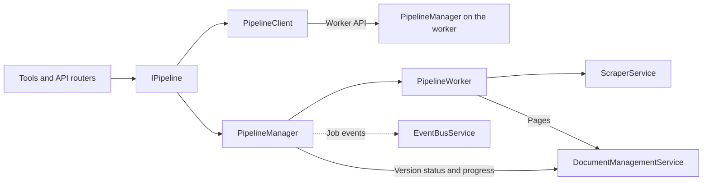
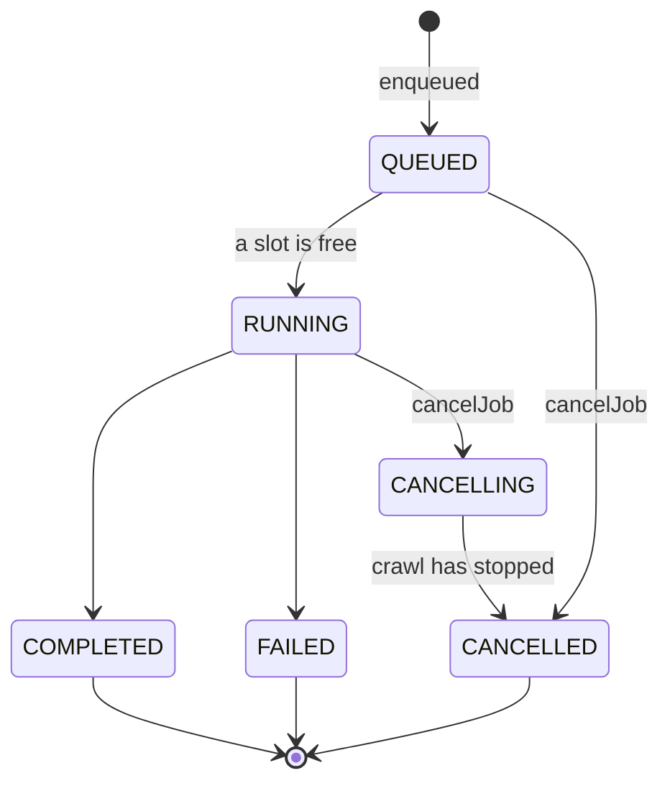

# Pipeline Architecture

The pipeline runs scrape and refresh jobs in the background. A job lives in the memory of the process that runs it, and every change to it is written through to the library version it targets, so the store always shows what a job is doing and what it left behind. [ARCHITECTURE.md](../../ARCHITECTURE.md) covers how entry points open a backend and how the two deployment modes connect. This page covers how jobs run, end, and survive a restart.

## Components

Every caller uses one interface, `IPipeline` ([src/pipeline/trpc/interfaces.ts](../../src/pipeline/trpc/interfaces.ts)). It has two implementations:

- `PipelineManager` ([src/pipeline/PipelineManager.ts](../../src/pipeline/PipelineManager.ts)) runs jobs in this process. It owns the job queue, runs each job in a `PipelineWorker`, writes job state to the store and emits job events.
- `PipelineClient` ([src/pipeline/PipelineClient.ts](../../src/pipeline/PipelineClient.ts)) forwards every call to a remote worker, which runs a `PipelineManager` of its own.

`openBackend()` ([src/services/backend.ts](../../src/services/backend.ts)) creates one or the other, starts it, and stops it when the backend closes; see [Backend Selection](../../ARCHITECTURE.md#backend-selection). No caller starts or stops a pipeline itself.

`PipelineWorker` ([src/pipeline/PipelineWorker.ts](../../src/pipeline/PipelineWorker.ts)) runs one job. It asks `ScraperService` to crawl and stores what each page produced through `DocumentManagementService`.

## Jobs and Versions

A job targets one library version, and two records describe it:

- The job record lives only in memory, in the `PipelineManager` that runs it. `getJob` and `getJobs` read it from there. Clearing finished jobs or restarting the process forgets it.
- The version row in the store is the durable record. It holds the status, the progress counters, the error message, and the scraper options the job ran with.

Each status change and each progress report updates both records, then emits an event on the [event bus](eventbus-architecture.md). Other processes on the same store, a restarted worker, and the web UI's library views all read the version row. A failed write to it is logged and does not stop the job.

The stored scraper options leave out what belongs to one run, such as a refresh's page queue (`withoutRunOnlyOptions` in [src/scraper/types.ts](../../src/scraper/types.ts)). Refreshes and recovered jobs therefore run with the original scrape's settings.

## Job Lifecycle

Cancelling a queued job removes it from the queue at once. Cancelling a running job aborts its signal and marks it CANCELLING. Until the crawl has stopped, the job can still be storing a page, so the version row stays RUNNING and the job becomes CANCELLED only then. `waitForJobCompletion` resolves for completed and cancelled jobs and rejects for failed ones, in both implementations.

## Running Jobs

`PipelineManager` starts jobs in the order they were enqueued and runs up to `scraper.maxConcurrency` of them at once. The same setting bounds how many pages one crawl fetches at once, so a busy process can have that many jobs each fetching that many pages.

A worker first clears the version, unless the job is a refresh or the scrape asked to append (`clean: false`). It then turns each page outcome into a store action:

- A page with content replaces whatever the store holds for that page.
- A page that is empty now is recorded as empty. When its pipeline failed instead, the stored page stays as it was.
- A page that is gone is deleted, when it came from the store.
- Unchanged, skipped and failed pages change nothing.

A failed write for one page is logged and the job goes on. A failed deletion fails the job, because it would leave the page's chunks searchable. [Refresh Architecture](refresh-architecture.md) describes the outcomes a refresh produces.

Each outcome also advances the job's progress counters. The `scrape-progress-reporting` spec ([openspec/specs/scrape-progress-reporting/spec.md](../../openspec/specs/scrape-progress-reporting/spec.md)) defines them, and [Scrape progress counters](../../ARCHITECTURE.md#scrape-progress-counters) summarizes them.

## One Version at a Time

Within one process, enqueueing a job and removing a version run one at a time for each library version (`withVersionLock` in `PipelineManager`). Library names match ignoring case, the way the store groups them.

- A scrape first claims its version in the store. By default an existing version is rejected; replacing or appending has to be asked for (`onExisting`, `clean: false`). Only a successful claim goes on to cancel the version's other jobs, so a rejected request cannot stop the job it conflicts with.
- A refresh holds the lock from reading the version's pages until its job is registered, so a removal cannot run in between.
- A removal cancels the version's jobs and waits until each has ended, including one that is already cancelling, before it deletes anything. A job enqueued for the version meanwhile registers after the removal.

## Interrupted Jobs

A process that exits while jobs run or wait leaves their versions RUNNING or QUEUED in the store. `stop()` does not cancel running jobs, so a shutdown leaves them unfinished too. Several processes can share one store, for example a server and a local `scrape`, or `web` beside an embedded stdio server, so a RUNNING or QUEUED version can also belong to a job another live process runs.

Every local pipeline therefore marks the versions of its unfinished jobs alive: from `start()` until `stop()`, it sets their `updated_at` to now every `scraper.jobHeartbeatMs` (15 s by default). Status and progress writes set it too. A version is interrupted once nothing has written it for four intervals plus one second, the resolution of `updated_at`.

Only the process that hosts the store's jobs should act on the jobs another run left behind. `openBackend()` therefore gives each local pipeline an `interruptedJobs` policy ([src/pipeline/types.ts](../../src/pipeline/types.ts)), which `PipelineManager.start()` applies to interrupted versions:

| Policy | Effect | Used by |
|---|---|---|
| `recover` | Enqueues each version again through `enqueueRefreshJob`. The version never completed, so this becomes a full re-scrape with its stored options. A version that cannot be enqueued, such as one without stored options, is marked FAILED. | `worker` (default), the default command with `--resume` |
| `fail` | Marks each version FAILED with "Job interrupted", so users can start it again. | `web`, `mcp`, the default command without `--resume`, `worker --no-resume` |
| `leave` | Changes nothing. | `scrape`, `refresh`, and `mcp` or the default command in read-only mode |

`scrape` and `refresh` run only their own job, and a read-only server runs none, so they leave the others to the server. A remote backend takes no policy, because the worker applies its own.

`start()` never treats the manager's own unfinished jobs as interrupted, such as jobs enqueued before it. A version written within the bound may belong to a live process, or to one that crashed moments ago, so `start()` checks it once more when the bound has passed: still unwritten, it gets the policy; written again, it is left to the process that runs it and not checked again. A server restarted right after a crash therefore recovers or fails the crashed job about a minute after it starts. The bound assumes every process on the store uses the same `jobHeartbeatMs`.

## Remote Pipeline

`PipelineClient` calls the worker's pipeline procedures ([src/pipeline/trpc/router.ts](../../src/pipeline/trpc/router.ts)) through the backend's shared API client. It removes a version through the application router's `removeDocs` ([src/services/appRouter.ts](../../src/services/appRouter.ts)), which cancels the worker's job for that version first. The coordinator keeps no job state of its own.

- Enqueue errors a caller can act on keep their tRPC code across the hop: an existing target, an invalid library name, and an unknown refresh target. A coordinator's API therefore answers like a local one.
- Before its first job, the client waits briefly for the worker's event stream, so a job that starts at once does not lose its first events. When the stream does not come up in time, it warns once and goes on.
- `waitForJobCompletion` settles on relayed `JOB_STATUS_CHANGE` events and also asks the worker for the job. The lookup covers an event lost around a reconnect and a job that finished before the wait began. A worker that no longer knows the job, because it was cleared or the worker restarted, ends the wait with an error.

One worker owns the job queue and the store, and coordinators scale out in front of it; see [Deployment Modes](../infrastructure/deployment-modes.md).
