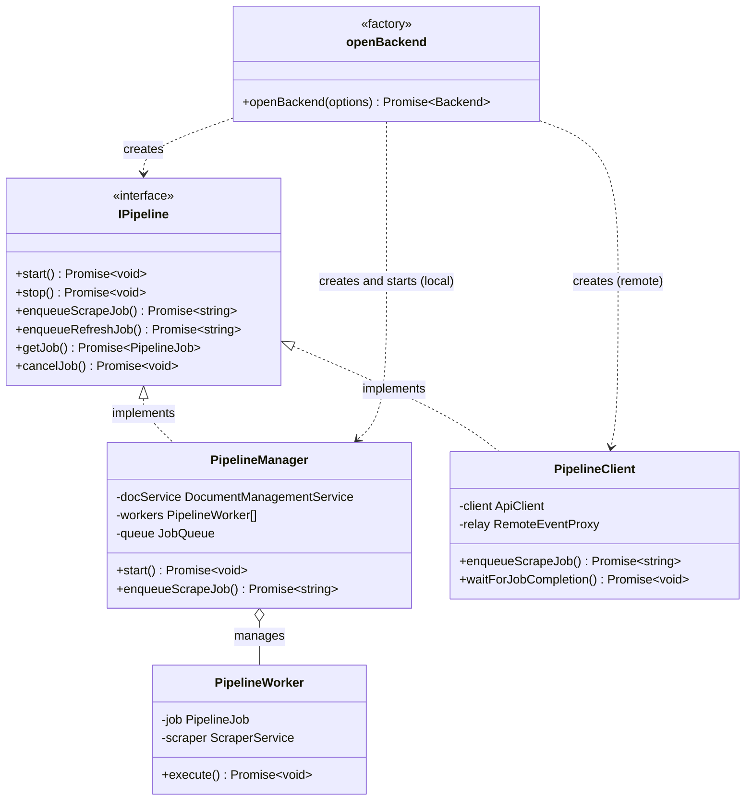

# Pipeline Architecture

## Overview

The pipeline system manages asynchronous document processing with persistent job state and coordinated execution across embedded or external workers.

## Architecture Pattern

One interface serves local and remote job processing. Every entry point gets its pipeline from `openBackend()`, which decides which implementation to create:



**Code Reference:** 
- `src/services/backend.ts` - `openBackend()`, which creates the pipeline and owns its lifecycle
- `src/pipeline/trpc/interfaces.ts` lines 20-35 - IPipeline interface
- `src/pipeline/PipelineManager.ts` - Local implementation
- `src/pipeline/PipelineClient.ts` - Remote implementation

## Core Components

### openBackend

Opens the services an entry point runs on and selects the pipeline implementation:

```typescript
interface OpenBackendOptions {
  serverUrl?: string; // External worker URL; local without it
  jobs?: false | { interruptedJobs: "recover" | "fail" | "leave" };
  // ...appConfig, eventBus, onEmbeddingModelChange
}
```

**Selection Logic:**

- `jobs: false` → no pipeline (read-only commands and the CLI `remove`)
- `jobs: { interruptedJobs }` with `serverUrl` → PipelineClient (external worker, which handles its own interrupted jobs)
- `jobs: { interruptedJobs }` locally → PipelineManager, started; `interruptedJobs` decides what it does with the versions an earlier run left RUNNING or QUEUED:
  - `recover`: runs them again as refresh jobs (`worker`, and the default command with `--resume`)
  - `fail`: marks them FAILED with "Job interrupted", so users can retry them (the other server commands)
  - `leave`: changes nothing (`scrape`, `refresh`, and `mcp` or the default command started read-only). These run only their own job, or none; a server on the same store may be running the others

### PipelineManager

Manages job queue and worker coordination for embedded processing:

**Responsibilities:**

- Job queue management with concurrency limits
- Worker lifecycle management
- Progress tracking and status updates
- Database state synchronization
- Job recovery after restart

**Job Recovery:**

- Set to `recover`, loads QUEUED and RUNNING jobs from the database on startup
- Resets RUNNING jobs to QUEUED for re-execution
- Maintains job configuration for reproducible processing

### PipelineClient

Provides the PipelineManager interface for an external worker by calling the worker's application API:

**Features:**

- Job operations over the backend's shared API client
- Identical method signatures to PipelineManager
- Waits briefly for the worker's event stream before its first job, so the job's first events reach this process
- `waitForJobCompletion` settles on relayed events, with a job lookup as a safety net

### PipelineWorker

Executes individual jobs with progress reporting:

**Execution Flow:**

1. Fetch job configuration from queue
2. Initialize scraper with job parameters
3. Process content through scraper pipeline
4. Update progress via callbacks
5. Store results and mark completion

## Job Lifecycle

### Job States

```
QUEUED → RUNNING → COMPLETED
              ↓
            FAILED
              ↓
           CANCELLED
```

### State Transitions

- **QUEUED**: Job created, waiting for worker
- **RUNNING**: Worker processing job
- **COMPLETED**: Successful completion
- **FAILED**: Error during processing
- **CANCELLED**: Manual cancellation

### Progress Tracking

Jobs report progress through a callback, once per queued item, carrying four
counters and the outcome that item reached. The `scrape-progress-reporting`
capability defines them normatively; in short:

| Counter | Meaning |
|---|---|
| `totalDiscovered` | URLs admitted to the crawl queue, unbounded |
| `totalPages` | Items the job expects to process — the denominator |
| `pagesScraped` | Items dequeued and given an outcome — the numerator |
| `pagesIndexed` | Items that produced stored content |

`pagesScraped` converges on `totalPages`, because every queued item is
eventually dequeued and reaches exactly one outcome. `totalPages` is **not** the
configured `maxPages`: it is the number of queued URLs, clamped at the point the
crawl will stop. Since `maxPages` bounds indexed pages rather than attempts, that
stopping point is `maxPages` plus however many items produced nothing.

Each event names its outcome — stored, unchanged, absent, empty, skipped or
failed — rather than leaving consumers to infer one from a null result. A null
result alone cannot distinguish a page that is unchanged from one that is now
empty, and those call for opposite handling: the first says keep what is stored,
the second says the page exists and holds nothing.

## Write-Through Architecture

### Single Source of Truth

PipelineJob objects contain both runtime state and database fields, ensuring consistency between memory and persistent storage.

### Immediate Persistence

All state changes immediately write to database:

- Status transitions
- Progress updates
- Error information
- Configuration changes

### Recovery Mechanism

Database state enables automatic recovery in the process that hosts the store (a pipeline set to `recover`):

1. Load pending jobs on startup
2. Reset RUNNING jobs to QUEUED
3. Resume processing with original configuration
4. Maintain progress history

## Concurrency Management

### Worker Pool

PipelineManager maintains configurable worker pool:

- Default concurrency: 3 workers
- Configurable via environment or CLI
- Workers process jobs independently
- Queue coordination prevents conflicts

### Job Distribution

Jobs are distributed to available workers using:

- FIFO queue ordering
- Worker availability checking
- Load balancing across workers
- Graceful worker shutdown handling

## External Worker RPC

### Procedures (tRPC)

- `ping` - Connectivity check
- `enqueueJob` - Create new job
- `getJobs` - List jobs with optional filtering
- `getJob` - Get job details
- `cancelJob` - Cancel a job
- `clearCompletedJobs` - Remove completed/cancelled/failed jobs

### Data Contracts

Requests and responses use shared TypeScript types through tRPC, ensuring end-to-end type safety.

### Error Handling

Errors propagate as structured tRPC errors with messages suitable for user feedback and logs.

## Configuration Persistence

### Job Configuration

Each job stores complete scraper configuration:

- Source URL and scraping parameters
- Library name and version information
- Processing options and filters
- Retry and timeout settings

### Reproducible Processing

Stored configuration enables:

- Exact re-indexing with same parameters
- Configuration auditing and debugging
- Version-specific processing rules
- Consistent results across runs

## Monitoring and Observability

### Progress Reporting

Real-time progress updates through:

- Callback-based progress notifications
- Database persistence of progress state
- Web UI polling for status display
- Log-based progress tracking

### Error Tracking

Comprehensive error information:

- Exception stack traces
- Processing context at failure
- Retry attempt logging
- User-friendly error messages

### Performance Metrics

Job execution metrics:

- Processing duration
- Pages processed per minute
- Memory and resource usage
- Queue depth and throughput

## Scaling Patterns

### Vertical Scaling

Increase worker concurrency within its single process:

- Higher `maxConcurrency` limits
- More memory allocation
- Faster storage backend

### Horizontal Scaling (Coordinators Only)

The worker is a single process that owns the in-memory job queue and the SQLite-backed document store — it does not scale horizontally. What scales horizontally is the coordinator tier:

- Run multiple `web`/`mcp` coordinator replicas, each started with `--server-url` pointing at the same worker
- Coordinators are stateless; both document reads (`DocumentManagementClient`) and job dispatch (`PipelineClient`) proxy to the one worker over one API client
- Load balance across coordinator replicas, not worker replicas

### Deployment Modes Are Exclusive

A deployment runs with either an embedded worker (a local backend, standalone mode) or a single external worker started separately and reached via the coordinator's `--server-url` flag (distributed mode) — not both at once.
