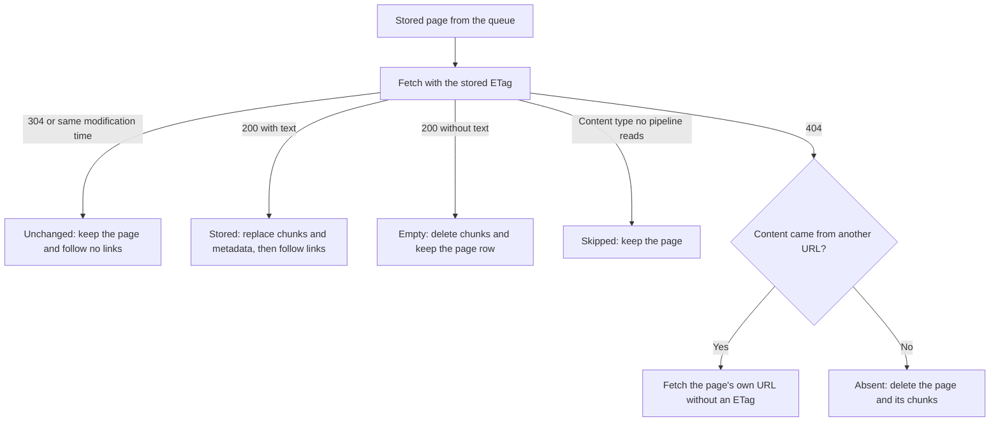

# Refresh Architecture

A refresh re-indexes a library version that is already indexed and processes only the pages that changed. It is an ordinary scrape job with two additions: a queue that starts with every stored page, and the validator (ETag) each page was stored with. Scrapes and refreshes share the strategies, fetchers, pipelines and store writes.

`RefreshVersionTool` (the CLI `refresh` command and the MCP `refresh_version` tool), the web UI's refresh buttons and [job recovery](pipeline-architecture.md#interrupted-jobs) all start a refresh through the pipeline's `enqueueRefreshJob`.

## Starting a Refresh

`PipelineManager.enqueueRefreshJob` ([src/pipeline/PipelineManager.ts](../../src/pipeline/PipelineManager.ts)) decides what kind of job to run:

- A library or version that is not indexed, or a version without pages, fails with an error.
- A version that never completed, because its scrape was interrupted or failed, is scraped again from scratch with its stored options. A refresh follows links only from pages that changed (see [Discovering Pages](#discovering-pages)), so it would never reach the pages an incomplete crawl missed.
- Any other version gets a refresh job. Its queue holds each stored page with its URL, crawl depth, page ID and ETag. The job reuses the options the version was scraped with, such as headers, URL patterns and scrape mode, and is marked as a refresh, so the worker does not clear the version first.

The crawl ([src/scraper/strategies/BaseScraperStrategy.ts](../../src/scraper/strategies/BaseScraperStrategy.ts)) starts from that queue and adds the root URL at depth 0 when no stored page has it.

## Change Detection

Each source tells "unchanged" in its own way:

- Web pages, including npm and PyPI documentation and GitHub wiki pages: `HttpFetcher` sends the stored ETag as `If-None-Match`, and a `304` means unchanged. `Last-Modified` is stored but not sent. A page that needs the browser fallback is fetched without a validator, so it comes back in full every time.
- GitHub repository files: stored under their `github.com` blob URL, and fetched with their ETag from `raw.githubusercontent.com`.
- Local files: `FileFetcher` derives the ETag from the file's modification time and compares it without reading the file.
- A stored page without an ETag, such as a file inside a local archive, is always fetched in full.

## Page Outcomes

Every queue item reaches exactly one outcome (`PageOutcome` in [src/scraper/types.ts](../../src/scraper/types.ts)), and `PipelineWorker` turns it into a store action.

- Unchanged: nothing is written. The body is not downloaded, so the page's links are not followed.
- Stored: the store embeds the new chunks, then in one transaction deletes the page's old chunks, updates the page row with the new ETag, and inserts the new chunks (`DocumentStore.addDocuments`). When a redirect moved the page, the same transaction removes the row under the old URL.
- Empty: the page exists and holds nothing, so its chunks are deleted and its new ETag is stored. When the pipeline failed rather than finding no text, the stored page stays as it was, old ETag included, so the next refresh fetches it again.
- Absent: the page row and its chunks are deleted (`DocumentStore.deletePage`). A `404` for a stored page is a deletion, not a failure, so it does not count toward `scraper.abortOnFailureRate`. A failed deletion fails the job. When the stored content came from another URL than the page's own, such as a Markdown file recorded under its HTML page, the refresh asks the page's own URL before it deletes anything.
- Skipped, or failed under `ignoreErrors`: nothing changes, and the stored page stays.

Only a `404` removes a page. Other errors leave stored content alone.

## Discovering Pages

Every stored page is checked directly, because the queue starts with all of them. New pages come only from links, and only a page fetched in full yields links. For a website this is enough: a page that gains a link has changed, so the server sends it in full and the crawl follows the new link.

Sources with listings read them again on every refresh:

- A local directory is a listing, not a stored page, so it is listed again and its new files are queued.
- A GitHub repository's root reads the repository tree through the GitHub API on every run.
- A website's `llms.txt` is probed again, as in a scrape.

Stored pages keep the depth they were found at, and a new link gets its parent's depth plus one, so `maxDepth` limits a refresh as it limits a scrape. `maxPages` counts the pages a run stores, so unchanged pages do not use it up.

A page that still exists but that nothing links to any more stays indexed, since it is in the queue and answers `304` or `200`.

## Design Decisions

- The queue starts with every stored page. Unchanged pages yield no links, so a crawl from the root alone would stop at the first unchanged page. Checking each stored page with a conditional request costs one small request per unchanged page and finds every deletion.
- Deletion is immediate and complete. A `404` removes the page row and its chunks at once, so deleted content leaves search results right away. No history of deleted pages is kept.
- The ETag lives on the page row ([Data Storage](data-storage.md) has the schema) and is written in the same transaction as the page's chunks. A stored ETag therefore always describes the content the store holds, and a page whose processing failed keeps the ETag of the content that is still stored.

The E2E suites `test/refresh-pipeline-e2e.test.ts`, `test/local-file-refresh-e2e.test.ts`, `test/empty-page-refresh-e2e.test.ts` and `test/markdown-identity-e2e.test.ts` pin these behaviors.
