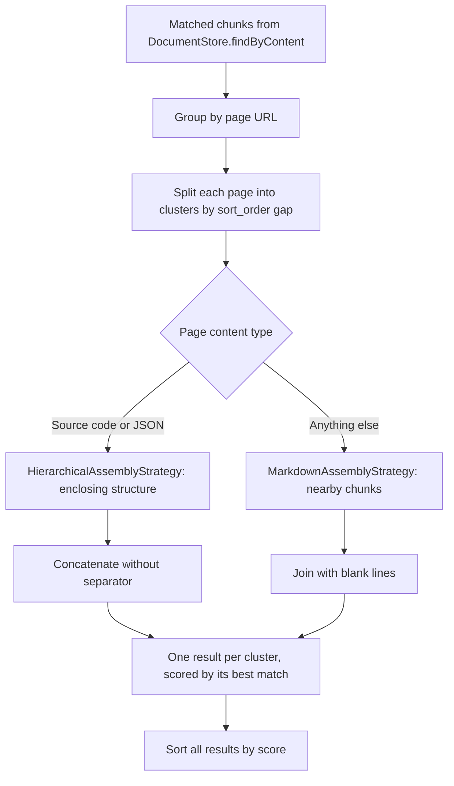

# Search Result Reassembly

A search matches individual chunks, but one chunk is often too small to answer a question. `DocumentRetrieverService` ([src/store/DocumentRetrieverService.ts](../../src/store/DocumentRetrieverService.ts)) turns the matches into readable passages. It groups them by page, splits each page's matches into nearby clusters, and lets an assembly strategy chosen by content type add the surrounding chunks and join them. Each cluster becomes one result.

How the store finds and ranks the matches is described in [Data Storage](data-storage.md#search). The parent, sibling and child relationships used below are defined in [Splitter Hierarchy](splitter-hierarchy.md#relationships).

## Flow

## Grouping and clustering

Matches are grouped by page URL. Within a page they are ordered by position (`sort_order`) and split wherever two neighbours are more than `assembly.maxChunkDistance` positions apart. Matches close together share one passage. Matches far apart in a long page come back as separate results rather than one passage that spans the page.

The number of results can therefore differ from the search limit. The limit applies to matched chunks; grouping merges them and clustering splits them again.

## Choosing a strategy

`createContentAssemblyStrategy` ([src/store/assembly/ContentAssemblyStrategyFactory.ts](../../src/store/assembly/ContentAssemblyStrategyFactory.ts)) picks the strategy from the page's stored content type. `HierarchicalAssemblyStrategy` takes source code and JSON, as `MimeTypeUtils.isSourceCode` and `MimeTypeUtils.isJson` classify them. `MarkdownAssemblyStrategy` takes everything else, including pages without a content type.

The split follows how the content was chunked. Prose is merged into readable chunks that share their section's path, so a few neighbours give enough context. Code and JSON keep one chunk per structure, so the strategy can rebuild the structure a match sits in.

### Markdown strategy

For each match, `MarkdownAssemblyStrategy` collects the match, its parent, up to `assembly.precedingSiblingsLimit` siblings before it, up to `assembly.childLimit` children, and up to `assembly.subsequentSiblingsLimit` siblings after it. It fetches the union once, in document order, and joins the chunks with a blank line, which keeps paragraphs, lists and headings apart.

### Hierarchical strategy

`HierarchicalAssemblyStrategy` returns the structure that contains the match rather than a fixed window.

A single match in a page brings its nearest chunk typed `structural` (a class, interface, enum or namespace), which is the match itself when the match is a declaration, the scopes that enclose it, and its subtree. When source code has no structural ancestor, as for a top-level function, the first chunk of the top-level element named by the match's first path segment takes its place. JSON has no structural chunks, and its top-level element is the whole document, so a JSON match brings the object or array it opens (a key whose value is an object or array, even an empty one), otherwise the one that contains it. A match at the page root comes back on its own.

The subtree is the ancestor, the chunks right before it that carry the same path (such as a JSON key and its bracket), and the chunks right after it whose path starts with the ancestor's path, up to the first chunk outside it. It therefore ends with the ancestor's closing line, which carries the ancestor's own path. Each enclosing scope adds its opening and closing lines but none of its other members, so the passage is balanced without pulling in the rest of the page. A scope opens where the run of chunks inside its path begins, so a statement or member between its declaration and the match is left out. The structural chunk is found the same way, so a field between two methods does not hide the class. `assembly.maxParentChainDepth` bounds the number of enclosing scopes.

Several matches in one page bring the subtree of each match and the opening and closing lines of every scope around it, but none of the scopes' other members, so unmatched methods of the same class stay out. Inside the scope that holds all the matches, the chunks at that scope's own path, such as fields, come along too. Matches that share no path each come back inside their own scopes.

A scope that no chunk opens, such as a level the splitter skipped, is passed over and the next shorter path is tried. `assembly.maxParentChainDepth` bounds the number of enclosing scopes. If loading the page fails, the strategy falls back to each match with its parent and a few children.

The chunks are concatenated without a separator. Source code chunks carry their own line breaks, so adjacent chunks join back into the original lines. JSON chunks carry their own commas and brackets, so a complete selection joins into compact JSON. A comma that separated the selection from a left-out sibling stays in place.

## Scores and order

Each result keeps the highest score among its matched chunks; chunks added as context do not change it. All results are then sorted by score, so a strong match that clustering separated from weaker ones on the same page still comes first.

A result also carries the page URL, the URL its content was retrieved from when that differs, and the page's processed and source content types.

## Reading a page

The `read_page` tool (`ReadPageTool`, backed by `DocumentManagementService.getPageContent`) joins a run of consecutive chunks of one page with the same strategy, so a page reads the same way as a search result. It adds no context. It returns whole chunks up to a character budget and the position to continue from.

## Adding a strategy

Search and `read_page` never join chunks themselves; they hand a page's chunks to its strategy. Supporting a new kind of content therefore means adding a strategy, not changing the search path. A strategy implements `ContentAssemblyStrategy` ([src/store/assembly/types.ts](../../src/store/assembly/types.ts)): `canHandle` claims content types, `selectChunks` picks the chunks that belong in the passage around the matches, and `assembleContent` joins chunks that are already in document order.

The factory asks each strategy in turn and uses the first that accepts the content type. `MarkdownAssemblyStrategy` accepts every type, so it stays last and a new strategy goes before it. A strategy can only select along the relationships its content's splitter records, so check which splitter produces the chunks and what level and path it assigns before claiming a content type; see [Splitter Hierarchy](splitter-hierarchy.md).

## Configuration and requirements

The `assembly` settings are listed under Assembly in [Configuration](../setup/configuration.md). The requirements, with examples, are in the [search-result-reassembly spec](../../openspec/specs/search-result-reassembly/spec.md).
