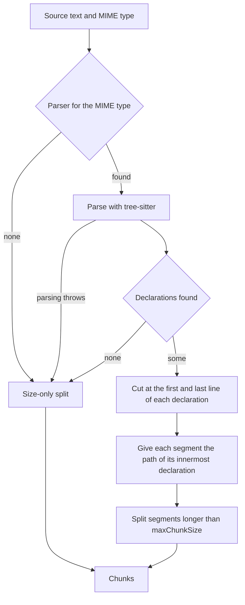

# Source Code Splitter

`TreesitterSourceCodeSplitter` ([src/splitter/treesitter/](../../src/splitter/treesitter/)) splits files for `SourceCodePipeline`. For a language with a tree-sitter parser, it cuts the file at its declarations: each function, method, class or interface becomes its own chunk, with a path made of the names of the declarations around it. For every other language, it cuts by size only.

The chunks are built for `HierarchicalAssemblyStrategy`, which rebuilds the code around a search match, for example the whole class around a matched method. See [Search Result Reassembly](search-result-reassembly.md). [Supported Formats](supported-formats.md#source-code) lists which files reach this splitter.

## Principles

Concatenation reproduces the file. The chunks cover every line of the file exactly once, in order, whitespace included, so assembly can join any run of neighboring chunks and get the original source back. The splitter tests assert this for TypeScript and Python. The one exception is a very long line, described under [How a File Is Cut](#how-a-file-is-cut).

Each declaration gets its own chunk. Boundaries come from the syntax tree. In TypeScript and JavaScript they are classes, interfaces, type aliases, enums, namespaces and modules, import statements, functions, methods, constructors, and variables declared outside a function body. In Python they are classes, functions and import statements. A function declared inside another function's body stays part of that body, while the methods of a class or interface and the declarations inside a namespace get chunks of their own.

Comments stay with their code. A block of comments directly above a declaration starts that declaration's chunk, even across an `export` keyword. Python docstrings sit inside the body and need no special handling.

Paths come from declaration names. A method's path is `["ClassName", "methodName"]`, and its level is the path's length. Code outside every declaration has an empty path at level 0. The file name is not part of the path, because the page URL already identifies the file.

Structural chunks anchor assembly. Classes, interfaces, type aliases, enums, namespaces, modules and imports are structural; functions, methods, constructors and variables are content. The first chunk of a structural declaration, which holds its documentation, its signature and anything before its first member, gets the types `["code", "structural"]`. Every other chunk gets `["code"]`. `HierarchicalAssemblyStrategy` looks for the nearest structural ancestor of a match to decide how much code to return.

## How a File Is Cut

The splitter cuts the file at the lines where declarations start and end, and gives each segment the path of the innermost declaration that contains it. A class therefore yields a chunk for its header, one for each method, and one for each stretch of code between or after its members, such as the closing brace; all of them except the methods carry the class's path. Whitespace-only segments join the chunk that follows them.

A segment longer than `splitter.maxChunkSize` goes to `TextContentSplitter`, which cuts it at blank lines, then line breaks, then spaces. The pieces keep the segment's path. Cuts at blank lines and line breaks keep the text intact. A segment that contains a line longer than `maxChunkSize` is cut at spaces instead, and the whitespace at those cuts is not kept exactly.

`LanguageParserRegistry` maps MIME types to parsers. `TypeScriptParser` handles TypeScript, TSX, JavaScript and JSX with one grammar family, and picks the TSX grammar when the source looks like JSX. `PythonParser` handles Python.

## Fallbacks

The splitter falls back to a size-only split when the MIME type has no parser, when parsing throws, or when the parse finds no declarations. A size-only split keeps the file as one chunk with an empty path if it fits in `splitter.maxChunkSize`, and otherwise cuts it with `TextContentSplitter`.

A parse with syntax errors logs a warning, and the splitter uses the declarations tree-sitter still recognized. The code around them becomes part of the surrounding chunks.

A file longer than `splitter.treeSitterSizeLimit` is parsed only up to that limit, cut at a line break, because the tree-sitter binding fails on longer input. Declarations in the parsed part become chunks as usual. The rest of the file becomes chunks with an empty path.

## No Size Merging

`SourceCodePipeline` does not pass these chunks through `GreedySplitter`, unlike the Markdown and text pipelines. Merging small neighbors would put unrelated declarations in one chunk and lose the paths that hierarchical assembly depends on. A small chunk, such as a one-line method, is still a meaningful search target. `JsonPipeline` skips merging for the same reason.

## Adding a Language

A new language needs a `LanguageParser` (see [parsers/types.ts](../../src/splitter/treesitter/parsers/types.ts)) whose `extractBoundaries()` returns the declarations, each classified as structural or content, and a registration in `LanguageParserRegistry`. Its MIME type must also have a language mapping in `MimeTypeUtils.extractLanguageFromMimeType()`, or `SourceCodePipeline` never receives the file.
