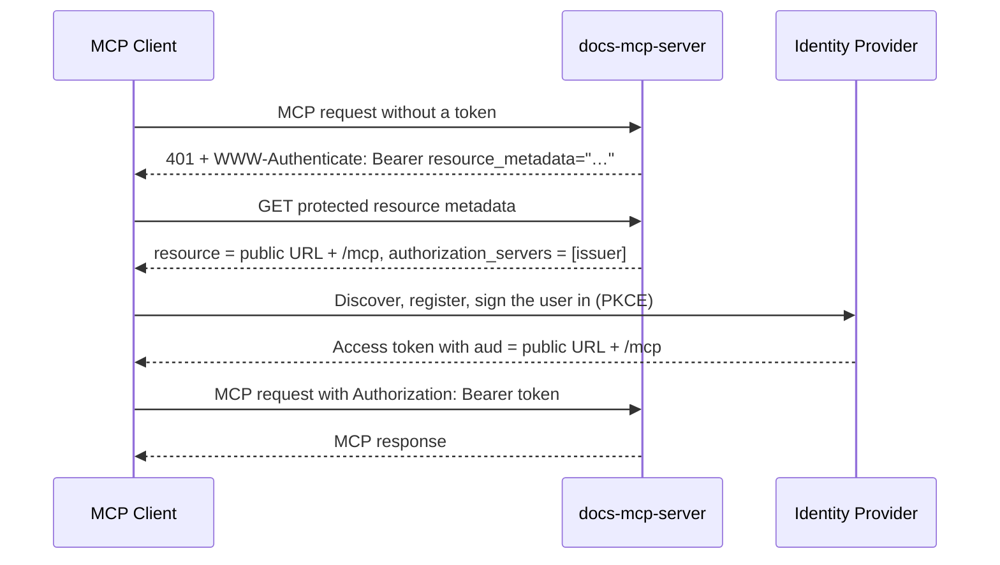

# Authentication

## Overview

Every HTTP MCP request requires credentials. By default, the server accepts client access tokens stored in its database. With `auth.enabled: true`, it accepts OAuth 2.0 access tokens from the configured identity provider instead; database client tokens are not accepted in that mode.

In OAuth mode, the server is an OAuth 2.0 **resource server**. It does not issue OAuth tokens, register OAuth clients, or host provider sign-in pages. An external identity provider (Clerk, Auth0, Keycloak, Microsoft Entra ID, and others) does all of that. MCP clients discover the provider from the server, sign the user in there, and send the token they receive with every request. The server accepts a token only when it is a JWT that the configured provider issued for this server.

OAuth mode follows the [MCP authorization specification](https://modelcontextprotocol.io/specification/2026-07-28/basic/authorization) (protocol revision 2026-07-28).

## What Authentication Protects

| Surface | Protected by authentication | How to protect it |
|---|---|---|
| MCP endpoint (`/mcp`) over HTTP | Yes | Bearer token, as described here |
| Deprecated SSE transport (`/sse`, `/messages`) | Yes | Database client token on the stream and every message; unavailable in OAuth mode |
| MCP over stdio | No | The host that launches the process is the trust boundary. Enabling auth logs a warning. |
| Web UI | No | A reverse proxy with its own sign-in (OAuth2-Proxy, Authelia, Traefik forward-auth, Cloudflare Access), or a private network |
| MCP token and statistics procedures under `/api` | Yes | Separate administrative key; these operations use HTTP only |
| Other HTTP API procedures and subscriptions | No | Same as the web UI. On a loopback bind the server also rejects requests from foreign browser origins. |
| Worker link (`--server-url`) | MCP management procedures only | The worker and coordinators share `DOCS_MCP_ADMIN_TOKEN`; other procedures require a private network |

At startup the server states this boundary, naming the protected MCP endpoint. When authentication is enabled on a command that serves no MCP endpoint over HTTP (`web`, `worker`), it warns that OAuth protects no MCP endpoint in that process. The separate administrative key still protects MCP management procedures.

For putting the web UI and API behind a reverse proxy, see [Reverse Proxy Deployment](./reverse-proxy.md).

## Database Client Tokens and Administration

`DOCS_MCP_ADMIN_TOKEN` (or `auth.adminToken`) configures a separate operator key. An unset key disables all MCP token-management and statistics procedures. A client access token never grants administrative access. The operator key travels in an `Authorization: Bearer <ADMIN_KEY>` header and is not accepted as a database client token on `/mcp`.

In **Settings**, the operator unlocks MCP administration with this key, creates client tokens with comments, copies them and revokes them. The browser keeps the operator key only in tab memory. Reloading the page locks administration again. Initial client-token creation logs only its database ID, never the secret.

Clients send `Authorization: Bearer <CLIENT_TOKEN>` or `x-api-key: <CLIENT_TOKEN>` on every HTTP request. Tokens in URL parameters are not accepted. The legacy SSE transport checks the message token against the stream owner on every message, so revocation prevents further calls on an existing session.

The coordinator and remote worker use the same administrative key in distributed deployments. The coordinator sends it in HTTP headers when verifying client tokens and recording statistics. Administrative operations over the API WebSocket are denied.

MCP over stdio retains the host process as its authentication boundary. Its tool calls are recorded as local stdio activity.

## How OAuth Clients Authenticate



1. A request without a valid token gets `401` with `WWW-Authenticate: Bearer resource_metadata="<public URL>/.well-known/oauth-protected-resource/mcp"`. When the request carried a token that was rejected, the challenge also carries `error="invalid_token"`.
2. The protected resource metadata (RFC 9728) names the MCP endpoint's public URL as `resource` and the configured issuer as the only authorization server. Its `resource_name` is the server's title, or its name when there is no title, so clients that show it at sign-in use the same name as everywhere else. It is served at the URL in the challenge and at the RFC 9728 well-known location, and it is readable from any origin.
3. The client talks to the provider directly. It asks for a token for the `resource` it just learned, per RFC 8707.
4. The client sends `Authorization: Bearer <token>` on every request.

## Configuration

| Setting | CLI | Environment | Required | Description |
|---|---|---|---|---|
| `auth.enabled` | `--auth-enabled` | `DOCS_MCP_AUTH_ENABLED` | – | Selects OAuth mode instead of database client tokens. |
| `auth.adminToken` | – | `DOCS_MCP_ADMIN_TOKEN` | for administration | Separate operator key protecting token management and statistics. |
| `auth.issuerUrl` | `--auth-issuer-url` | `DOCS_MCP_AUTH_ISSUER_URL` | yes | The provider's issuer identifier, an `https` URL. It must match the `issuer` the provider publishes exactly, including any trailing slash. |
| `server.publicUrl` | `--public-url` | `DOCS_MCP_SERVER_PUBLIC_URL` | yes | The URL clients use to reach the server, e.g. `https://docs.example.com` or `https://example.com/docs`. |
| `auth.audience` | `--auth-audience` | `DOCS_MCP_AUTH_AUDIENCE` | no | The audience tokens must carry, an absolute URL or a URN. It defaults to `<public URL>/mcp`. |

The `--auth-*` flags exist on the commands that serve MCP: the default command and `mcp`. The environment variables and the configuration file apply to every command.

The advertised `resource` and the expected audience both derive from `server.publicUrl`. The server never guesses them from its bind address or from the request's `Host` header. That is why a public URL is required, and startup fails with an error naming the missing setting.

```bash
npx @arabold/docs-mcp-server@latest \
  --auth-enabled \
  --auth-issuer-url "https://your-app.clerk.accounts.dev" \
  --public-url "https://docs.example.com"
```

Tokens must then carry `aud` = `https://docs.example.com/mcp`.

At startup the server fetches the provider's metadata from the same well-known locations MCP clients try, RFC 8414 first and then OpenID Connect Discovery. Startup fails when no document answers, when the published `issuer` differs from `auth.issuerUrl`, or when the metadata has no `jwks_uri`. The error lists the URLs it tried.

## Identity Provider Requirements

Whatever provider you use, it needs to:

- Issue JWT access tokens signed with keys published in its `jwks_uri`. The server rejects opaque tokens.
- Put this server in `aud`. Ideally the provider sets `aud` from the RFC 8707 `resource` parameter the client sends, which is `<public URL>/mcp`. A provider that issues a fixed audience works too: set `auth.audience` to that value. The override must name an API or resource identifier, never a client ID, or the provider's ID tokens would be accepted as access tokens.
- Let MCP clients register themselves, through Client ID Metadata Documents (preferred in MCP 2026-07-28) or Dynamic Client Registration (RFC 7591).
- Support PKCE with S256.

### Clerk

Enable these OAuth application settings on the Clerk instance:

| Setting | Value | Why |
|---|---|---|
| JWT access tokens (`oauth_jwt_access_tokens`) | on | Clerk issues opaque tokens otherwise |
| `aud` claim (`aud_claim_enabled`) | on | Clerk sets `aud` to the requested `resource` |
| PKCE required (`pkce_required`) | on | MCP clients always use PKCE |
| Dynamic client registration | on | Lets MCP clients register themselves |
| Client ID Metadata Documents (`client_id_metadata_documents_advertised`) | recommended | The registration method MCP 2026-07-28 prefers |

With the [Clerk CLI](https://clerk.com/docs/cli):

```bash
clerk api /instance/oauth_application_settings --app <app_id> --instance dev \
  -X PATCH -d '{"oauth_jwt_access_tokens":true,"aud_claim_enabled":true,"pkce_required":true}'
```

Then run the server with `--auth-issuer-url https://<your-app>.clerk.accounts.dev` and your public URL. You don't need `auth.audience`.

## Token Validation

The server accepts a request only when its bearer token:

- is a JWT signed with a key the configured issuer publishes,
- has `iss` equal to the configured issuer,
- has an `aud` that contains the expected audience,
- and has not expired.

In OAuth mode there is no other path to MCP access. A token issued for another application on the same provider is rejected, and so is any opaque token. If the provider's keys can't be retrieved, the request fails with `500` rather than `401`, so clients don't restart sign-in because of a provider outage.

Access is binary: any valid token for this server grants every MCP tool.

## Troubleshooting

**Startup fails with "no public URL is configured".** Set `server.publicUrl` (or `--public-url`) to the URL clients use.

**Startup fails with "Auth configuration validation failed".** `auth.issuerUrl` must be an `https` URL, and `auth.audience`, when set, an absolute URL or a URN.

**Startup fails because `auth.issuerUrl` "does not match the issuer the authorization server publishes".** Copy the `issuer` value from the provider's metadata exactly. A trailing slash counts.

**Clients get `401` with `error="invalid_token"`.** Decode the token (for example at [jwt.io](https://jwt.io)) and compare:
- `aud` should equal `<public URL>/mcp`, or `auth.audience` if you set one;
- `iss` should equal `auth.issuerUrl`;
- `exp` should be in the future.

With Clerk, a missing `aud` or an opaque token means the settings above aren't enabled.

**A client can't find the provider.** Check that the `resource_metadata` URL from the challenge is reachable from the client. Behind a reverse proxy it must pass through: see [Reverse Proxy Deployment](./reverse-proxy.md).

**Debug logging.** Run with `--verbose` to see token verification failures.

## Security Considerations

Serve the MCP endpoint over HTTPS, through TLS termination at a reverse proxy: the server itself speaks plain HTTP, and bearer tokens travel in every request.

The [host and origin checks](./security.md#inbound-requests) apply whether authentication is on or off. Authentication controls who may call MCP tools, not where the scraper connects or which files it reads; [Infrastructure Security](./security.md) covers those limits.
